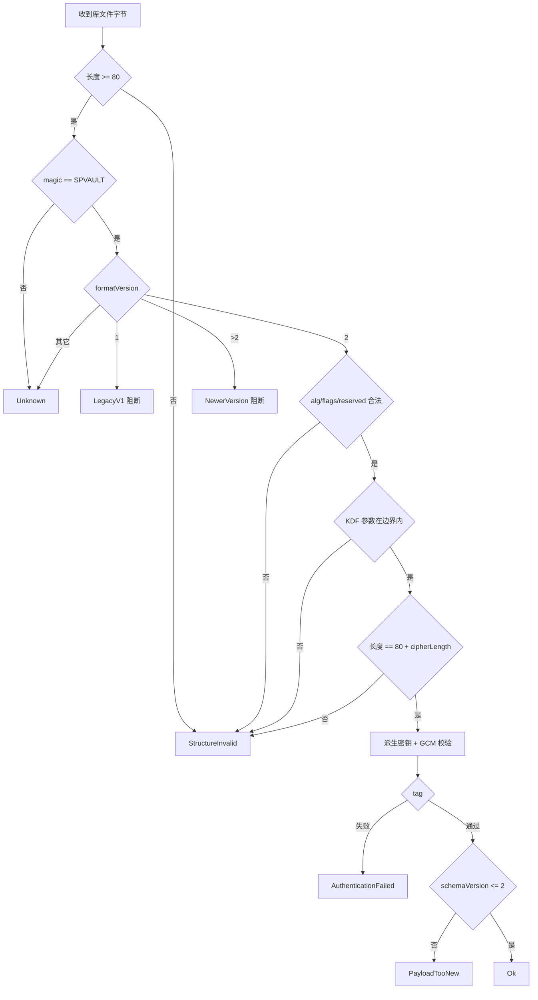
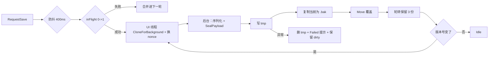
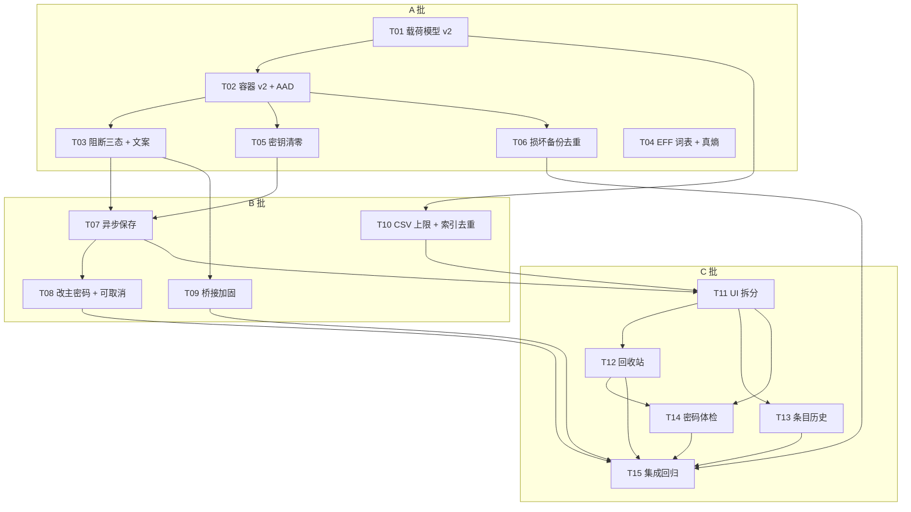

# SnapFlow 本地密码库（Vault）增量优化 · 系统设计与任务分解

| 项 | 内容 |
|---|---|
| 文档 | `docs/vault-optimization/02-design.md`（增量设计，基线 = v1.1.4 已上线实现） |
| 上游 | `docs/vault-optimization/01-prd.md`（16 条需求、A/B/C 三批次、13 条已拍板硬决策） |
| 代码基线 | `src/Jietu/Services/Vault/*`（11 文件 1787 行）、`src/Jietu/PasswordWindow.xaml.cs`（1849 行）、`tests/Jietu.Tests`（130 用例） |
| 技术栈 | WinUI 3 + .NET 10 x64，命名空间 `Jietu`，**不新增第三方依赖**（仅现有 `Isopoh.Cryptography.Argon2`） |
| 配套图 | `02a-class-diagram.mermaid`、`02b-sequence-diagrams.mermaid`（与本文内嵌图同源） |
| 语言 | 全部面向用户文案为简体中文 |
| 修订 | r2：按评审意见处理 2 处矛盾 + 3 处口径（见文末 14.0「评审结论」） |

**阅读顺序建议**：第 2 章（格式规格，一切改动的地基）→ 第 3 章（类与线程规则）→ 第 4 章（模型不变式）→ 第 10 章（任务表，工程师的执行清单）→ 第 14 章（评审结论与待拍板偏差）。

---

## 1. 实现路径与技术选型

### 1.1 核心难点与对策

| # | 难点 | 本质 | 对策（本设计的选择） |
|---|---|---|---|
| D1 | 头部必须被认证，且不能靠"再存一个校验和"来伪造完整性 | 摘要自身可被重算，只有**密钥绑定**的认证才可信 | 头部 80 字节整体作为 AES-GCM 的 **AAD**，与密文共享同一个 tag。头部任一字节变化 ⇒ tag 必败 |
| D2 | 不做 v1 兼容，但绝不允许数据意外消失 | 破坏性变更 × 用户不可逆损失 | 版本判定前置到"派生密钥之前"，v1 走**只读分类**路径；该路径代码里没有任何写盘调用（不是"记得别写"，而是**拿不到写入口**） |
| D3 | 主线程不能阻塞（G4 < 50ms） | WinUI 3 单线程 UI + Argon2 半秒级 | 只把**不可并行的 UI 触碰**留在 UI 线程（捕获快照），KDF/AES/IO 全部 `Task.Run`；用 `DispatcherQueue` 做一次性编组 |
| D4 | 异步保存与"锁定即清密钥"天然冲突 | 密钥生命周期 > 异步任务生命周期 | 密钥清零做成**屏障**：`FlushAsync()` → 取 `_keyGate` → 清零。保存任务在 `_keyGate` 内只做一次 AES |
| D5 | 1849 行巨型文件的安全拆分 | partial 共享 x:Name 与状态字段 | 单 XAML + 多 `partial` 逻辑文件（零视觉变化），新增面板用独立 `UserControl` |
| D6 | 体检/回收站/历史的持久化字段必须一次预留在 v2 | 再升 v3 = 二次破坏用户数据 | `schemaVersion=2` + `recycleBin`/`history`/`healthIgnores`/`criticalOverride` 全部进 v2 载荷；预留 `flags`/`reserved0`/`reserved1` 头部位 |
| D7 | 7776 词表进源码（~50KB） | 体积 vs 真实熵 | 纯静态字符串数组（无解析、无 IO、零启动成本），每行 16 词、按字母序，方便 review 与追加许可声明 |

### 1.2 技术选型（不引入新依赖，全部使用 BCL）

| 能力 | 选型 | 理由 |
|---|---|---|
| KDF | `Isopoh.Cryptography.Argon2`（Argon2id / v1.3，参数来自头） | 现状保留；`ClearPassword = true` 让库自行清零口令缓冲 |
| AEAD | `System.Security.Cryptography.AesGcm`（12B nonce / 16B tag / AAD） | 已有；.NET 10 上走 CNG/AES-NI |
| 零化 | `CryptographicOperations.ZeroMemory` | 不会被 JIT 优化掉（`Array.Clear` 理论上可能被消除） |
| JSON | `System.Text.Json` + **源生成**（`JsonSerializerContext`） | 标准库；源生成降低 5000 条目序列化耗时并去掉反射开销 |
| 节流/单飞 | `SemaphoreSlim(1,1)` + `Interlocked` 版本号 + `CancellationTokenSource` | 需求是"合并"而非"排队"，`Channel` 会排空所有写入（10 次编辑写 10 次），语义不符 |
| 防抖 | `DispatcherQueueTimer`（已有用法）+ 后台 `Task.Delay` | 与现有代码风格一致 |
| 原子写 | `.tmp` + `File.Move(overwrite:true)` + `stream.Flush(true)` | 现状保留（Windows 上 Move 到同卷目标为原子替换） |
| 配对原子化 | `Interlocked.CompareExchange` on `PendingPair?` | 无锁、语义单一（"抢占唯一的 pending 槽位"） |
| 限流 | 令牌桶（容量 60，1 枚/秒 + 超限进入 60s 冷却） | 比固定窗口平滑，且天然支持"超限后暂停 1 分钟" |
| 审计 | 自写内存环形缓冲（`VaultAuditRecord[200]` + `lock`） | 不落盘（决策 7 / Q13） |
| 体检并发 | `Task.Run` + 条目间 `ct.ThrowIfCancellationRequested()` | 报告是纯函数，可单测可重算 |

### 1.3 架构模式

- **分层**：`UI(PasswordWindow partials + Views/UserControl)` → `会话编排(VaultSession, VaultSaveScheduler)` → `领域服务(VaultRecycleBinService / VaultHistoryService / VaultHealthService / VaultPairingGate / VaultRateLimiter / VaultAuditLog)` → `基础设施(VaultCrypto / VaultFormat / VaultStore / VaultBackupRotation)`。
- **纯函数优先**：加密、格式判定、体检、回收站/历史规则、URL 匹配、CSV 解析全部是 static 纯函数或纯数据变换 ⇒ 单测覆盖率不依赖 UI。
- **单向数据流**：UI 只改 `VaultData`（UI 线程）→ `RequestSave()` → 快照 → 后台落盘。UI 从不直接碰文件。

---

## 2. v2 容器格式规格（SEC-02 / SEC-03 / ROB-09 / F1–F7）

### 2.1 文件总体结构

```
[ header 80B ] [ body = ciphertext(N B) + tag(16B) ]
总长度必须严格等于 80 + cipherLength
```

- 明文载荷 = `VaultData` 的 UTF-8 JSON（见第 4 章），长度 `cipherLength - 16`。
- 每次写盘都重新生成 nonce；salt 仅在"新建库 / 改主密码"时更换（**没有"KDF 升级换 salt"这条路径**，见 2.9）。

### 2.2 头部逐字节布局（`VaultFormat.HeaderLength = 80`）

**80 是怎么来的（评审提出的对账）**：v1 头是 `8 magic + 4 version + 16 salt + 4 iterations + 4 memory + 4 parallelism + 12 nonce = 52`。v2 在 52 的基础上新增 **28 字节**：

```
52（v1 全部字段）
+ 4  kdfAlg        ← 新增：算法标识（进 AAD 防降级）
+ 4  aeadAlg       ← 新增：算法标识（进 AAD 防降级）
+ 4  flags         ← 新增：位标记（未知位必须拒绝）
+ 4  reserved0     ← 新增：预留槽
+ 4  cipherLength  ← 新增：解密前的结构校验
+ 8  reserved1     ← 新增：预留槽
= 80 字节（不是 68；只数 4 个 uint 会少算 reserved0/cipherLength/reserved1 的 16 字节）
```

| # | 偏移 | 长度 | 字段 | 编码 | 取值 / 约束 | 是否进 AAD |
|---|---|---|---|---|---|---|
| 1 | 0 | 8 | `magic` | ASCII | `"SPVAULT\0"`（`53 50 56 41 55 4C 54 00`） | ✔ |
| 2 | 8 | 4 | `formatVersion` | uint32 LE | **`2`**；`1` ⇒ 旧库阻断；`>2` ⇒ 版本过新；其它 ⇒ 未知格式 | ✔ |
| 3 | 12 | 4 | `kdfAlg` | uint32 LE | `1` = Argon2id（Argon2Version.Nineteen）；其它 ⇒ 不支持 | ✔ |
| 4 | 16 | 4 | `aeadAlg` | uint32 LE | `1` = AES-256-GCM（12B nonce / 16B tag）；其它 ⇒ 不支持 | ✔ |
| 5 | 20 | 4 | `kdfIterations` | int32 LE | `1..16`（派生密钥前完成边界校验） | ✔ |
| 6 | 24 | 4 | `kdfMemoryKiB` | int32 LE | `8192..1048576`（结构上限 1GiB）；导入外来文件时另加**策略上限** 262144（256MiB） | ✔ |
| 7 | 28 | 4 | `kdfParallelism` | int32 LE | `1..16` | ✔ |
| 8 | 32 | 4 | `flags` | uint32 LE | v2 必须为 `0`；非 0 ⇒ `UnsupportedFeature`（防"未知语义被静默忽略"） | ✔ |
| 9 | 36 | 4 | `reserved0` | uint32 LE | 必须 `0`（预留：载荷压缩、AEAD 算法族、容器族标识） | ✔ |
| 10 | 40 | 16 | `salt` | 随机 | CSPRNG；同一次解锁周期内不变 | ✔ |
| 11 | 56 | 12 | `nonce` | 随机 | CSPRNG；**每次写盘重新生成** | ✔ |
| 12 | 68 | 4 | `cipherLength` | uint32 LE | `= body.Length = plaintextLen + 16`，必须 `≥ 17` | ✔ |
| 13 | 72 | 8 | `reserved1` | uint64 LE | 必须 `0`（预留：条目数快照 / 写盘时间戳 / KDF 策略 id，各占 4 字节） | ✔ |

**`cipherLength` 冗余的意义（评审问：为什么不放进密文里）**

它是**给解密前用的结构校验位**，明文放头里、同时进 AAD，因此它既不泄漏内容（长度本来就可从文件大小推出），也不可能被伪造（改了 tag 必败）。收益有三条：

1. **不进 Argon2 就能判定畸形文件**（步骤 7）：截断/追加/伪造长度在派生密钥前就变成 `StructureInvalid`，省掉 0.5~2s 的 KDF，也避免用户为一个截断文件反复试密码；
2. 给 `AesGcm.Decrypt` 一个可交叉验证的长度（`body.Length` 与 `cipherLength` 必须一致），把"实现写错导致越界"变成显式失败而不是加密库的未定义行为；
3. 满足 F2"载荷长度若写入头部必须被认证"。

代价：4 字节 + 一条不变式（写盘时必须同步更新，单测按偏移断言）。若去掉它，解密前无法区分"截断"与"密码错"，会把结构性损坏伪装成"密码错误"——**这条体验/诊断收益值 4 字节**，故保留。

> 与 v1 的关系：magic 与 `formatVersion` 位置**刻意保持一致**（偏移 0..12），这样"版本"是唯一的格式分派依据，不需要靠文件长度或其它字段去猜。v1 头长 52 字节，其 `salt` 起于 12、参数在 28/32/36、`nonce` 在 40 —— 这些偏移在 v2 里被 `kdfAlg/aeadAlg/flags/reserved0` 占用，但由于**先按版本分派**，两套布局永不互相误读。

### 2.3 AAD 的确切构造

**"标签"是什么**：16 字节 ASCII **域分隔标签**（domain separation label），字面量 `SnapFlowVault/v2`，逐字节：

```
53 6E 61 70 46 6C 6F 77 56 61 75 6C 74 2F 76 32
 S  n  a  p  F  l  o  w  V  a  u  l  t  /  v  2
```

它**不是** magic（magic 是文件头前 8 字节 `"SPVAULT\0"`，用于识别"这是不是一个 SnapFlow 库文件"），而是喂给 GCM 的认证前缀，用途见下。

```csharp
// VaultFormat.BuildAad —— 实现者照抄即可
var aad = new byte[AadLabel.Length + 1 + HeaderLength];   // 16 + 1 + 80 = 97
AadLabel.CopyTo(aad.AsSpan(0, 16));                       // "SnapFlowVault/v2" ASCII
aad[16] = 0x00;                                           // NUL 分隔
headerBytes.CopyTo(aad.AsSpan(17, 80));                   // 必须用 ToBytes() 的**实际写盘字节**
// GCM：aes.Encrypt(nonce, plaintext, cipher, tag, tagSizeInBytes: 16, associatedData: aad)
```

| 片段 | 长度 | 内容 |
|---|---|---|
| `label` | 16 | ASCII `SnapFlowVault/v2` |
| `separator` | 1 | `0x00` |
| `header` | 80 | `VaultHeader.ToBytes()` 的输出（**与写盘字节完全一致，不允许"重新序列化一遍"**，否则字段默认值差异会导致自己解不开） |
| 合计 | **97** | `VaultFormat.AadLength` 常量，单测断言 |

**为什么这样能防降级（三条独立理由）**

1. **参数被签名**：`kdfAlg / kdfMemoryKiB / kdfIterations / kdfParallelism / aeadAlg / salt` 全在 AAD 内。攻击者把 64MiB→8MiB、4 次→1 次，AAD 立刻变化，tag 校验失败 —— 弱化参数无法与既有密文共存。
2. **算法标识被签名**：`aeadAlg=1` 在 AAD 内，无法把文件"降级"到一个非认证算法上再解。
3. **域分隔标签**：标签里带 `v2` 与产品名，意味着同一密钥/同一套字节结构在**其它协议**（`hello.blob` 的 12B nonce + 密文、未来 v3 或其它容器）中不会互相验证通过；NUL 分隔保证"标签+头"拼接无歧义（标签定长，NUL 是第二道保险）。

**版本号自认证**：`formatVersion` 既在 AAD 内（改了 tag 必败），又参与**分派**（`=1` 直接走阻断，根本不进解密）。所以"把 v2 伪造成 v1"这件事的结果是 —— 被识别为旧库并拒绝，永远不会解出内容（满足 F1、G2 的"伪造为 v1 头返回格式不支持"）。

### 2.4 tag 校验顺序（顺序本身就是安全措施）

| 步 | 动作 | 失败分类 | 为什么必须在这一步 |
|---|---|---|---|
| 1 | `File.ReadAllBytes` | `IoFailed` | — |
| 2 | `raw.Length >= 80` | `StructureInvalid`（Truncated） | 后续所有读取都要越界保护 |
| 3 | magic 8 字节比较 | `Unknown` | 不是我们的文件 ⇒ 不能当"损坏"处理 |
| 4 | `formatVersion` 分派：`1`→`LegacyV1`；`>2`→`NewerVersion`；`≠2`→`Unknown` | 见左 | **必须在 Argon2 之前**：旧库/未来库都不该花 0.5s 去试 |
| 5 | `kdfAlg/aeadAlg/flags/reserved0/reserved1` 等于期望值 | `StructureInvalid`（UnsupportedFeature） | 防"未知语义静默降级" |
| 6 | KDF 参数在边界内（含导入时的策略上限） | `StructureInvalid` | **防 Argon2 DoS**：畸形参数（1GiB）不能变成放大器 |
| 7 | `raw.Length == 80 + cipherLength` 且 `cipherLength ≥ 17` | `StructureInvalid` | 截断/追加在派生密钥前就发现，省 0.5s 并给出准确分类 |
| 8 | Argon2id 派生 32B 密钥（线程池） | — | 唯一昂贵步骤，放在所有静态检查之后 |
| 9 | `AesGcm.Decrypt(nonce, body[..^16], tag, plaintext, tagSize:16, aad)` | `AuthenticationFailed` | 密码错/头篡改/密文篡改在此汇合 |
| 10 | `JsonSerializer` 反序列化 + `schemaVersion` 检查 | `StructureInvalid` / `PayloadTooNew` | 明文已认证，此处失败基本等于自身 bug 或更高版本载荷 |
| 11 | `VaultData.Normalize()`（null 集合兜底、去重、孤立历史清理） | — | 容错，不抛 |

> **注意步骤 7 与 9 的取舍**：GCM 本身能发现截断（tag 必败），但先做长度校验可以把"畸形文件"与"密码错"分开，避免用户因为一个截断文件反复试密码。代价是把"文件是否被截断"暴露给了本地攻击者 —— 这不是秘密（文件长度本来就可见），收益更大。

### 2.5 「篡改头部任一字节 ⇒ 解密必败」推理

设头部字节向量 `H`（80B）、AAD `A = L ‖ 0x00 ‖ H`、密钥 `K = Argon2id(pw, salt∈H)`、tag `T = GMAC_K(A, C)`。

- 对 `H` 做单字节扰动得到 `H'`，`A' ≠ A`（标签定长且其后恰有 1 字节 NUL，拼接无歧义，不存在"两个不同 `H` 拼出同一个 `A`"的情况）。
- GCM 的认证方程 `T = GHASH_K(A,C) ⊕ E_K(J0)` 中 `A` 作为多项式系数参与运算；`A'≠A` 时等式成立需要 GHASH 碰撞，单密钥下的概率上界为 `2^-128`。
- 特殊子集单独看，失败得更早、更硬：
  - `magic` / `formatVersion` / `kdfAlg` / `aeadAlg` / `flags` / `reserved*` / 参数越界 / `cipherLength` 不匹配 ⇒ **步骤 3–7 直接拒绝，根本不派生密钥**（连 tag 计算的机会都没有，不构成密钥侧信道）。
  - `salt` 被改 ⇒ `K` 变化 **且** `A` 变化，双重必败。
  - `nonce` 被改 ⇒ `A` 变化 **且** CTR 计数器块 `J0` 变化，双重必败。
  - 参数被改成"仍在合法区间"的值（如 4→5 迭代）⇒ `K` 变化 + `A` 变化，双重必败。
  - body 任一字节（含 tag）被改 ⇒ GCM 直接失败。
- 因此：**20+ 个取样点（magic/version/kdfAlg/aeadAlg/params/salt/nonce/cipherLength/reserved 各取数点）100% 失败，且没有任何路径能返回明文**。测试用"逐字节翻转矩阵"锁定这一性质（见第 11 章）。

### 2.6 错误分类（枚举即契约）

```csharp
public enum VaultFileKind { Missing, Unknown, LegacyV1, V2, NewerVersion, StructurallyInvalid }

public enum VaultOpenStatus {
    Ok,
    AuthenticationFailed,   // tag 失败：密码错 或 头/体被篡改（不可区分，也不该区分）
    StructureInvalid,       // 头部结构/参数/长度不合法（含 UnsupportedFeature）
    PayloadTooNew,          // 载荷 schemaVersion > 支持版本
    LegacyFormat,           // formatVersion == 1
    NewerFormat,            // formatVersion > 2
    UnknownFormat,          // magic 不匹配 / 版本为 0 等
    IoFailed,
    Cancelled,
}

public enum VaultBlockKind { None, LegacyV1, IntegrityFailure, NewerVersion, UnknownFile }
```

**判定表（检测 → 分类 → 用户可见态 → 写盘副作用）**

| 检测结果 | `VaultOpenStatus` | 用户可见 | 阻塞态 | 写盘副作用 |
|---|---|---|---|---|
| 文件不存在 | — | 走"新建库" | `Missing` | 无 |
| `formatVersion == 1` | `LegacyFormat` | 旧库阻断卡（PRD 原文） | `Blocked(LegacyV1)` | **零**：不备份、不改名、不删、不写 |
| `formatVersion > 2` | `NewerFormat` | 版本过新卡 | `Blocked(NewerVersion)` | **零** |
| magic 不符 / version 0 | `UnknownFormat` | 校验失败卡 | `Blocked(UnknownFile)` | 去重备份（≤1/会话，≤3 份，≤50MB） |
| 结构/参数/长度不合法 | `StructureInvalid` | 校验失败卡 | `Blocked(IntegrityFailure)` | 去重备份（同上） |
| tag 失败 | `AuthenticationFailed` | **卡片结构（评审+产品定稿）**：标题 `无法解锁密码库` ／ 正文 `主密码不正确，或这个密码库已损坏／被修改。` ／ 路径行 `文件保存在：{path}` +「打开所在文件夹」 ／ 辅助 `如果确认主密码无误，可从加密备份恢复。` ／ 按钮 `重试`（**默认**）、`用备份文件恢复`、`关闭` | **不进入 `Blocked`**：`重试` = 清空密码框 + 聚焦 + 停留原页 + **不重新读盘**，用户改个密码就能再试 | **零**（可能是输错密码，不能生成产物） |
| 载荷 schema 过新 | `PayloadTooNew` | 版本过新卡 | `Blocked(NewerVersion)` | **零** |
| 读取异常 | `IoFailed` | 读取失败提示 | 不阻塞 | 无 |

> 关键区分：**"结构不合法"才备份，"认证失败"不备份。** 前者是不可解析的字节垃圾（有保存价值），后者可能只是一次手滑的密码。
>
> **G2 验收口径映射**：头部逐字节翻转后，落在"结构不合法"的那部分走阻断卡（「密码库校验失败」），落在 `salt`/`nonce`/区间内参数上的那部分走「无法解锁密码库」三层面板 —— **两种呈现的正文里都明确出现"已损坏／被修改"字样**，且都拒绝解密、不改原文件。这样既满足"任一头字节被改都给出损坏提示"，又不剥夺用户重试密码的权利。

### 2.7 v1 与 v2 的判别方法（唯一入口）

```csharp
VaultFileKind VaultFormat.Classify(ReadOnlySpan<byte> raw);
```

1. `raw.Length == 0` → `Unknown`。
2. `raw[0..8] != "SPVAULT\0"` → `Unknown`（注意：**不做模糊匹配**，也不尝试"跳过垃圾前缀"）。
3. `v = ReadUInt32LE(raw[8..12])`；`v == 1` → `LegacyV1`；`v == 2` → 继续结构校验（通过则 `V2`，否则 `StructurallyInvalid`）；`v > 2` → `NewerVersion`；否则 `Unknown`。
4. 判别只依赖 `raw` 本身，**不依赖文件长度、不依赖路径、不做部分解密**（F5）。

### 2.8 全入口一致性（SEC-03 的落地清单）

| 入口 | 触发点 | v1 时的行为 |
|---|---|---|
| 主窗口解锁 | `OnUnlockClick` → `VaultSession.UnlockAsync` | 阻断卡 + 路径 + 打开文件夹 |
| Alt+P 热键 / 托盘 | 同上（同一窗口实例） | 同上（`Present()` 只切状态，不新增写路径） |
| Windows Hello 快速解锁 | `UnlockWithHelloAsync` | **分类必须严格先于 `HelloUnlock.UnwrapKeyAsync`**：`LegacyV1` 时直接阻断、**不弹 Hello 验证框**（别让用户白按一次指纹）；且 `hello.blob` **本身字节与哈希不变**（不许"顺手清理"）。理由：v1 库旁边常躺着 v1 时代的 `hello.blob`，这条路径最容易"先解 blob 再发现库不对"，白费一次生物识别、并可能把 blob 删掉造成信息丢失（验收用例 V1B-10） |
| 扩展桥 `status` / `get-logins` | `VaultSession.State` | `status` 返回 `blocked: "legacy-v1"`，`get-logins` 返回 `error vault-blocked` |
| 加密备份恢复 | `VaultImportExport.OpenEncryptedBackup` | 同一套 `Classify`，明确拒绝 |
| 新建库 | `CreateAsync` | 若库存在（含 v1）⇒ 拒绝；**绝不覆盖**（现状已是 `if (Exists) throw`，保留并补提示文案） |
| 保存 | `RequestSave` | `State != Unlocked` 时是空操作（拿不到 `_key`） |

> 实现纪律：`VaultStore` **不暴露**任何在"分类失败"路径上被调用的写方法给 `VaultSession` 的解锁分支（备份方法走独立入口且带 kind 校验），让"误写"在类型层面不可达。
>
> 与"自动产物"的关系（对齐产品的 5 入口要求）：**v1 / 更高版本 / 认证失败**三条路径产生的自动产物 = **0**（无 `.corrupt`、无 `.bak`、无 `.tmp`、无改名）。唯二例外都在"正常使用"路径上：① ROB-01 的结构性损坏备份（≤1/会话、≤3 份、≤50MB）；② ROB-03 的滚动备份 `.bak`（只在**保存成功**后产生，v1 阻断时根本没有保存动作）。

### 2.9 ROB-08（KDF 参数静默升级）：**本项目不实现**

**主依据（评审拍板后的正式理由，按重要性排序）**

1. **它会打开"解锁路径允许写盘"的后门 —— 这是不可接受的。** 整套安全纪律建立在**"解锁路径只读"**之上：格式判定 → 解密 → 交给 UI，任何一步都不碰磁盘。v1 阻断之所以能做到"文件字节与哈希不变"，正是因为这条纪律在类型层面成立（解锁分支拿不到写方法）。一旦保留"解锁时发现参数偏低就静默重写文件"，解锁路径就合法地获得了写权限，后续任何人加需求都会援引这个先例。**为省掉一次 0.5 秒的 KDF，把一条结构性安全边界换成可选优化，不划算。**
2. **功能没有服务对象。** 不做 v1 兼容 ⇒ 上线后所有库都是**新建**的 v2 库，创建时即用 `VaultKdfPolicy` 当前参数；加密备份也由本版本生成、参数同源。因此**不存在"历史遗留弱参数库"**，ROB-08 想服务的场景在本版本里不存在（只有测试里手工构造的样本才存在，那是在为不存在的用户写代码）。

**记录：一个不成立的旧论证。** 早前曾用"升级需要明文口令，而 SEC-04 要求解锁成功即清零 ⇒ 两者互斥"来论证该机制不可实现。**该论证不成立** —— 把口令生命周期延长到重加密完成再清零，SEC-04 依然能满足，只是纪律更松。它不能作为依据，仅作为演进记录保留；真正的依据是上面第 1、2 条。

**落地**：

| 项 | 做法 |
|---|---|
| 参数集中定义 | 新增 `VaultKdfPolicy`（→ `VaultFormat.cs` 内）：`Iterations / MemoryKiB / Parallelism` 三个常量 + `CreateHeader()`。未来提参数**只改这一处** |
| 使用点 | 仅两处：`VaultSession.CreateAsync`（新建库）、`VaultSession.ChangeMasterPasswordAsync`（改主密码）。明文备份里的 `BuildEncryptedBackup` 也复用同一策略 |
| 读到低参数 v2 文件 | 按**头部参数**正常解密（不升级、不提示、**不写盘**），仅 `Log.Info` 记一次参数值。参数合法区间由 `VaultFormat` 校验 |
| **反向断言（纳入验收）** | **解锁前后 `vault.spv` 的 SHA-256 必须完全相同** —— 这条断言同时锁住 ROB-08 的"不存在"、SEC-03 的"零写盘"和 SEC-04 的"解锁不产生副作用"。已写入 T02 与 T08 的验收标准 |
| 未来若真的要支持跨版本保留 | 必须先回答：为什么值得让解锁路径获得写权限（见主依据 1）、口令驻留窗口多长、驻留期如何防 dump、写失败如何回退。四条答完才允许重开。**当前不做** |
| PRD 对应 | ROB-08 标记为"因放弃 v1 兼容而自然消解，不单独实现"（与产品已确认的"不作为发布门槛"一致） |

---

## 3. 模块职责与类设计

### 3.1 新增 / 改造类型总表

| 类型 | 文件 | 职责（一句话） | 关键约束 |
|---|---|---|---|
| `VaultHeader`（改造） | `VaultFormat.cs` | v2 头部值对象 + 序列化 | `readonly struct`；字段不可变，`WithFreshNonce()` 返回新实例 |
| `VaultFormat`（新） | `VaultFormat.cs` | 格式常量、分类、AAD 构造、KDF 策略判定 | 纯静态，无 IO |
| `VaultFileKind` / `VaultOpenStatus` / `VaultBlockKind` / `VaultState`（新） | `VaultEnums.cs` | 错误与状态契约 | 只能扩展，不能改序（日志与测试锚定） |
| `VaultKey`（新） | `VaultKey.cs` | 32B 密钥的唯一持有者，`Dispose` 零化 | `sealed class`，**不用 struct**（防隐式复制） |
| `VaultCrypto`（改造） | `VaultCrypto.cs` | Argon2 派生 + GCM 加解密 + 载荷序列化/反序列化 | 全部方法接受/返回 `VaultKey`，不出现裸 `byte[]` 密钥 |
| `VaultPayloadWriter`（新） | `VaultPayloadWriter.cs` | 逐条目写 JSON（可取消、可报进度） | `Utf8JsonWriter`；条目间 `ct.ThrowIfCancellationRequested()` |
| `VaultStore`（改造） | `VaultStore.cs` | 纯读写 + 原子写 + 损坏备份去重 | 解锁分支只能调 `Read` |
| `VaultBackupRotation`（新） | `VaultBackupRotation.cs` | 滚动 3 版 + tmp 清理 | 只操作匹配自身命名规则的文件 |
| `VaultSaveScheduler`（新） | `VaultSaveScheduler.cs` | 防抖合并 + 单飞 + 失败回退 | 只做编排，不含密码学 |
| `VaultSession`（改造） | `VaultSession.cs` | 唯一解锁状态持有者 + 编排 | UI 线程亲和（见 3.7） |
| `VaultRecycleBinService`（新） | `VaultRecycleBin.cs` | 回收站增删恢复与淘汰 | 纯函数（入参 `VaultData`） |
| `VaultHistoryService`（新） | `VaultHistory.cs` | 历史记录/淘汰/回滚/差异摘要 | 纯函数 |
| `VaultHealthService`（新） | `VaultHealthService.cs` | 体检 5 维计算 | 纯函数，可重算 |
| `VaultCriticalDomains`（新） | `VaultCriticalDomains.cs` | 关键账号**关键词**表（子串匹配，命中即算关键账号） | 仅作提示不阻断 |
| `VaultSuffixPolicy`（新） | `VaultSuffixPolicy.cs` | 多级公共后缀拒绝表 + 标签数判定（防钓鱼后缀匹配） | 常量集中，匹配函数只调用 |
| `VaultPairingGate`（新） | `VaultPairingGate.cs` | 配对槽位原子化 | `Interlocked` |
| `VaultRateLimiter`（新） | `VaultRateLimiter.cs` | 令牌桶 60/min + 60s 冷却 | 线程安全 |
| `VaultAuditLog`（新） | `VaultAuditLog.cs` | 内存环形缓冲 200 条 | 不落盘、不含口令 |
| `VaultLimits`（新） | `VaultLimits.cs` | 全部魔数集中 | 唯一常量来源 |
| `VaultMessages`（新） | `VaultMessages.cs` | 全部中文文案集中 | 纯字符串，可单测 |
| `VaultJsonContext`（新） | `VaultJsonContext.cs` | STJ 源生成上下文 | 无反射序列化 |
| `PasswordGenerator`（改造） | `PasswordGenerator.cs` | 7776 词表 + 真熵 | 熵由 `WordListSize` 实算 |
| `EFFLargeWordlist`（新） | `EFFLargeWordlist.cs` | EFF 大词表 7776 词（CC BY 3.0） | 只读数组、小写 a-z |
| 5 个 `Views/*.xaml.cs`（新） | `src/Jietu/Views/` | 阻断卡 / 体检 / 回收站 / 历史 / 审计面板 | 自包含 XAML，不共享 x:Name |

### 3.2 关键公开签名（C# 级别）

```csharp
// ---- Services/Vault/VaultFormat.cs ----
public readonly struct VaultHeader
{
    public int Version { get; init; }               // == 2
    public uint KdfAlgorithm { get; init; }         // 1 = Argon2id
    public uint AeadAlgorithm { get; init; }        // 1 = AES-256-GCM
    public int Iterations { get; init; }
    public int MemoryKiB { get; init; }
    public int Parallelism { get; init; }
    public uint Flags { get; init; }                // 0
    public uint CipherLength { get; init; }
    public byte[] Salt { get; init; }
    public byte[] Nonce { get; init; }

    public static VaultHeader NewV2(int iterations, int memoryKiB, int parallelism);
    public VaultHeader WithFreshNonce();
    public byte[] ToBytes();                        // 80B，写盘用
}

public static class VaultFormat
{
    public const int HeaderLength = 80, TagLength = 16, NonceLength = 12, SaltLength = 16;
    public const int CurrentFormatVersion = 2;
    public const uint KdfArgon2id = 1, AeadAes256Gcm = 1;
    // KDF 结构边界（派生密钥前的 DoS 防线，与 v1 的上限一致）
    public const int MinMemoryKiB = 8 * 1024, MaxMemoryKiB = 1024 * 1024;
    public const int MinIterations = 1, MaxIterations = 16;
    public const int MinParallelism = 1, MaxParallelism = 16;
    public static ReadOnlySpan<byte> Magic => "SPVAULT\0"u8;
    public static ReadOnlySpan<byte> AadLabel => "SnapFlowVault/v2"u8;   // 16B

    public static VaultFileKind Classify(ReadOnlySpan<byte> raw);
    public static bool TryReadHeader(ReadOnlySpan<byte> raw, out VaultHeader header, out VaultOpenStatus status);
    public static byte[] BuildAad(VaultHeader header);                   // 97B，见 2.3
}

// KDF 策略的**唯一**定义处：未来提参数只改这里（新建库与改主密码都读它）
public static class VaultKdfPolicy
{
    public const int Iterations = 4;
    public const int MemoryKiB = 64 * 1024;
    public const int Parallelism = 4;
    public static VaultHeader CreateHeader();       // = VaultHeader.NewV2(Iterations, MemoryKiB, Parallelism)
}

// ---- Services/Vault/VaultKey.cs ----
public sealed class VaultKey : IDisposable
{
    public const int Length = 32;
    public bool IsDisposed { get; }
    internal ReadOnlySpan<byte> Bytes { get; }
    public VaultKey Clone();
    public void Dispose();                          // ZeroMemory，幂等
}

// ---- Services/Vault/VaultCrypto.cs ----
public readonly record struct VaultOpenResult(VaultOpenStatus Status, VaultData? Data, string? Detail)
{
    public bool Ok => Status == VaultOpenStatus.Ok;
}

public static class VaultCrypto
{
    public static VaultKey DeriveKey(ReadOnlySpan<byte> passwordUtf8, VaultHeader header);   // Argon2id，内部清零口令副本
    public static byte[] SealPayload(VaultHeader header, VaultKey key, ReadOnlySpan<byte> payloadJson);
    public static VaultOpenResult Open(VaultHeader header, VaultKey key, ReadOnlySpan<byte> body, byte[] aad);
    public static VaultOpenResult ParsePayload(ReadOnlySpan<byte> payloadJson);              // schemaVersion 检查 + Normalize
}

// ---- Services/Vault/VaultStore.cs ----
public readonly record struct VaultFileRead(byte[] Raw, VaultFileKind Kind, VaultHeader Header, byte[]? Body);

public static class VaultStore
{
    public static string? LastNotice { get; }        // 面向 UI 的恢复提示（可空）
    public static VaultFileRead Read(string path);   // 只读；不产生任何文件
    public static Task SaveAsync(string path, byte[] fileBytes, CancellationToken ct);   // tmp → 备份 → 原子替换 → 轮转
    public static int CleanupTemporaryFiles(string path);                                // 孤儿 tmp 清理，返回清理数
    public static IReadOnlyList<string> ListBackups(string path);
    public static string? TryCreateCorruptBackup(string path, VaultFileKind kind);        // 去重 + 上限
}

// ---- Services/Vault/VaultSaveScheduler.cs ----
// 快照 = UI 线程克隆出的结构化副本（容器全部新分配，string 是共享引用 ⇒ 不产生额外明文副本）
public sealed class VaultSnapshot
{
    public VaultHeader Header { get; init; }
    public VaultData Data { get; init; }          // = 源.CloneForBackground()
    public long DataVersion { get; init; }
}

public enum VaultSaveState { Idle, Saving, Saved, Failed }

public sealed class VaultSaveScheduler : IDisposable
{
    // captureOnUi：只在 UI 线程被调用（内部经 DispatcherQueue 编组），负责"克隆 + 换新 nonce"
    // persist    ：在后台线程执行（序列化 → 加密 → 落盘），是唯一碰 VaultKey 的地方
    public VaultSaveScheduler(DispatcherQueue ui,
                              Func<VaultSnapshot?> captureOnUi,
                              Func<VaultSnapshot, CancellationToken, Task> persist);
    public VaultSaveState State { get; }
    public DateTimeOffset? LastSavedUtc { get; }
    public event Action<VaultSaveState, string?>? StateChanged;

    public void Request();                                          // UI 线程；O(1) 立即返回
    public Task<bool> FlushAsync(CancellationToken ct = default);    // 等到"最后一次编辑"落盘
    public Task StopAsync();                                        // Dispose 前调用
}

// ---- Services/Vault/VaultModels.cs（新增成员）----
public sealed class VaultData
{
    /// <summary>UI 线程调用：为后台保存/改密克隆一份结构化副本。
    /// 只复制容器（List/VaultEntry/VaultEntryVersion/Tags），string 共享引用。
    /// 之后 UI 对源对象的就地修改不会影响副本（快照隔离）。</summary>
    public VaultData CloneForBackground();
    public void Normalize();                        // 不变式修复，见 4.6
}
```

### 3.3 密钥清零的承载方式（SEC-04）

| 材料 | 承载方式 | 清零时机 | 备注 |
|---|---|---|---|
| 主密码 UTF-8 字节 | 局部 `byte[]` + `try/finally` `ZeroMemory` | 派生结束后立刻 | **字符串本身无法清零**（见 3.3.1） |
| Argon2 内部口令副本 | `Argon2Config.ClearPassword = true` + 传入我们自己的缓冲（不再 `password.ToArray()` 造第二份） | `argon2.Dispose()` 时由库清零 | 现状 `ClearPassword = false` 且多拷一份，是 SEC-04 的直接缺陷 |
| Argon2 输出 | `SecureArray`（库自带）+ 拷进 `VaultKey` 后 `ZeroMemory(SecureArray.Buffer)` | 方法返回前 | 不再 `secureHash.Buffer.ToArray()` 直接外泄 |
| 解锁密钥 | `VaultKey`（`IDisposable`） | `Dispose` / 锁定 / 改密成功换钥 | 全仓不再出现裸 `byte[] _key` |
| Hello wrapKey | 局部 `byte[]` + `finally ZeroMemory` | `SealAsync`/`UnwrapKeyAsync` 返回前 | 签名缓冲同样在 `finally` 清零 |
| Hello 签名缓冲 | `finally ZeroMemory(signature)` | 同上 | `CryptographicBuffer.CopyToByteArray` 产生的那份 |
| 明文 JSON payload | 保存/改密管线内 `byte[]` + `finally ZeroMemory` | `SealPayload` 之后 | 快照的所有者（管线）负责清零 |
| 备份口令派生密钥 | `VaultKey` + `using` | `BuildEncryptedBackup` / `OpenEncryptedBackup` 结束 | 现状是裸 `byte[]` |
| 锁定时的明文引用 | `_data = null`（由 GC 回收托管字符串） | `Lock()` | .NET 无法擦除字符串内容，见 3.3.1 |

#### 3.3.1 已知限制（必须写进代码注释，不许假装做到了）

- 主密码来自 `PasswordBox.Password`（`string`，不可变），UTF-8 拷贝可以清零，**原字符串不能**。缓解：① 立即 `MasterBox.Password = ""`；② 全链路不拼接、不 `Split`、不打日志；③ 不在任何 `Dictionary` 键/异常消息里携带。
- 托管堆可能因 `string`→`byte[]` 中间分配产生短暂副本，**无法证明零残留**。因此 G3 的可测口径定为："**我们声明持有的缓冲在离开作用域后全为 0**"（可观测断言），而不是"堆里一个字节都没有"。
- `VaultData` 里的明文（title/password 等）在锁定后由 GC 回收，无零化能力 —— 这是 .NET 的固有约束，写进安全说明。

### 3.4 异步保存的并发原语与取消语义（ROB-03 / G4）

**选型：`SemaphoreSlim(1,1)` 单飞 + `Interlocked` 版本号合并 + 防抖计时器 + `DispatcherQueue` 捕获快照（克隆，不序列化）。**

```
Request():                       // UI 线程，O(1)
    Interlocked.Increment(ref _dirtyVersion)
    _debounce.Restart()          // 400ms
debounce tick:                   // 后台
    if (Interlocked.CompareExchange(ref _inFlight, 1, 0) != 0) return;   // 单飞：已有任务在跑
    loop:
        v0 = Volatile.Read(ref _dirtyVersion)
        snap = await _ui.EnqueueAsync(_captureOnUi)     // ← 唯一回到 UI 线程的一步：只做克隆 + 换 nonce
        if (snap == null) break                         // 锁定中/无库/阻断态
        async:  payload  = VaultPayloadWriter.Write(snap.Data)   // 后台：序列化（明文缓冲，finally 清零）
                body     = SealPayload(snap.Header, key, payload) // 后台：唯一借用 key 的地方
                await VaultStore.SaveAsync(...)                   // 后台：tmp → 备份 → move → 轮转
                ZeroMemory(payload)                               // finally
        if (Volatile.Read(ref _dirtyVersion) == v0) break         // 期间无新编辑 ⇒ 结束
    Interlocked.Exchange(ref _inFlight, 0)
```

| 语义 | 决定 |
|---|---|
| 合并 | 400ms 窗口内的 N 次编辑只落盘 1 次；保存期间的新编辑再合并成 1 次（"1 秒 10 次编辑 ⇒ 落盘 1~2 次"，满足 ROB-03） |
| 单飞 | `_inFlight` 互斥 + `SemaphoreSlim` 保护写文件；**同一时刻只有一个写盘者**，因此 tmp 文件名固定为 `vault.spv.tmp` 不会冲突 |
| 取消 | 保存任务本身不取消（写到一半取消更危险）；`StopAsync` 用于**退出程序**时取消并清 tmp。用户不可感知"取消保存" |
| 强制落盘 | `FlushAsync()`：置一个 `_flushTcs`，由循环在"本轮落盘成功且版本号稳定"时 `TrySetResult` |
| 失败 | 清理 tmp、保留旧文件、`StateChanged(Failed, "保存失败，已回退到上一个版本")`，**dirtyVersion 不清零** ⇒ 下一次 `Request()` 自动重试 |
| 锁定前 | `Lock()` 必须先 `await FlushAsync()`（超时 3s）→ 再 `_keyGate` → 再 `_key.Dispose()`。这是**密钥清零屏障**，否则可能在密钥清零后仍有任务在用 |
| 线程 | **UI 线程只做 `CloneForBackground()`，序列化与加密全部在后台**（评审 3.4 的结论，见 3.5） |
| 快照隔离依据 | 克隆复制全部可变容器（`Entries`/`RecycleBin`/`Tags`/`History`/每个 `VaultEntry` 与 `VaultEntryVersion` 对象）；`string` 不可变 ⇒ 共享引用即安全，且**不产生额外明文副本**（对 SEC-04 有利） |

> ❌ **明确否决的做法**：在 UI 线程"逐条目序列化 + 每 N 条 `Task.Yield()`"把耗时切碎。因为切碎期间 UI 仍可编辑 ⇒ 序列化过程读到半新半旧的数据，产出**撕裂快照**（可能丢字段或父子不一致）。正确性风险远大于 10~20ms 抖动。同理，`Utf8JsonWriter` 的分片写入只在**后台**做（那里数据已隔离）。

### 3.5 UI 线程耗时预算（G4 < 50ms 的落点）

评审关心的是"UI 线程还剩哪件重活、代价多少"。答案是**只剩深克隆**，并且它有确定上界（不随 payload 字节数增长，只随对象数增长）：

| 操作 | UI 线程做的事 | 预算（5000 条、每条第 5 版历史的最坏样本） | 实测口径 |
|---|---|---|---|
| 编辑提交 | 改 `_data` + `RequestSave()` | < 1ms | 停表埋点 |
| **保存快照** | `VaultData.CloneForBackground()`（只复制容器与对象，字符串共享引用） | **≤ 6ms**（≈ 5000×(1 entry + 1 tags list + 1 history list + 5 versions) ≈ 4 万次小分配） | `VaultPerfHarness` 三组样本：500 / 2000 / 5000 条 |
| 解锁 | 只做 UI 状态切换 | < 5ms | Argon2 全在后台 |
| 改主密码（启动） | 克隆 + 切到进度对话框 | ≤ 6ms | 同上 |
| CSV 导入 5000 条 | 解析在后台，UI 只做"合并 + 列表刷新" | 合并 < 15ms（索引去重） | 停表埋点 |
| 体检 5000 条 | 无（全后台 + 克隆一份数据引用） | 0 | — |

**取舍说明（为什么不是"UI 线程序列化"）**

| 方案 | UI 线程耗时（5000 条） | 额外内存 | 判定 |
|---|---|---|---|
| A. UI 线程序列化 payload | 1MB 典型 ≈ 10~15ms；6MB 最坏 ≈ 40~120ms | 无 | ✗ 最坏情况破 G4，且耗时随数据量线性增长，无法给上界 |
| **B. UI 线程克隆 + 后台序列化（采用）** | **≤ 6ms，上界与对象数相关、与字节数无关** | 一份容器副本（明文引用数为 0 增量） | ✔ 确定性满足 G4，且顺带为改密提供真进度/可取消 |
| C. UI 线程序列化 + 分片 `Yield` | 单次 < 8ms 但总时长变长 | 无 | ✗ 快照撕裂（见 3.4 否决说明） |

> 若将来条目数涨到 2 万，克隆会到 ~25ms 仍可接受；到那个量级应改为"条目对象不可变 + 列表浅拷贝"（copy-on-write），成本近乎 0。**当前不做**，记在技术债里。


### 3.6 滚动备份的命名与轮转（ROB-03 / Q11）

| 项 | 规则 |
|---|---|
| 命名 | `<库文件名>.yyyyMMdd-HHmmss.bak`，例 `vault.spv.20250304-142233.bak` |
| 同秒冲突 | 追加 `-2`、`-3`……（`vault.spv.20250304-142233-2.bak`） |
| 排序 | 文件名**按字典序即时间序**（`yyyyMMdd-HHmmss` 定长），无需读文件属性 |
| 轮转 | 每次成功写盘后：`EnumerateFiles(path + ".*.bak")` → 按名降序 → 保留前 3 → 其余删除 |
| 只删自己的 | 删除前必须匹配正则 `^vault\.spv\.\d{8}-\d{6}(-\d+)?\.bak$`；不碰用户其它文件 |
| 备份内容 | 上一版的**完整容器**（头+体），可直接当备份恢复（用当时的 salt/nonce） |
| 备份失败 | **不阻断保存**（原子替换本身已保证不留半文件），记 `Log` + `LastNotice` 轻提示 |
| 不可见性 | 目录内可见（Q11），但在"恢复备份"对话框里按时间倒序列出，供用户直接选 |

### 3.7 线程亲和规则（WinUI 3 必读，写进每个类的头注释）

| 成员 | 线程 | 说明 |
|---|---|---|
| `VaultData` 及其所有字段的**读写** | **仅 UI** | 任何后台读都会被编辑器并发写撕裂 |
| `VaultSession.Data` / `IsUnlocked` / `State` / `Block` / `DataVersion` | 仅 UI | 后台需要数据时走 `QueryLoginsAsync` 之类的**编组方法**，拿不可变数组 |
| `VaultSession` 的 `Unlocked` / `Locked` 事件 | 仅 UI | `Lock()` 的调用者（桥、托盘）必须 `DispatcherQueue.TryEnqueue` |
| `DispatcherQueueTimer`（空闲锁、TOTP、防抖） | 仅 UI | 现有用法不变 |
| `VaultSaveScheduler.Request` / `FlushAsync` 的调用点 | 仅 UI（`FlushAsync` 可后台 await，但内部切换） | 捕获快照内部编组到 UI |
| `VaultCrypto` / `VaultFormat` / `VaultStore` / `PasswordGenerator` / `Totp` / `VaultImportExport.ParseCsv` / `VaultHealthService` / `VaultRecycleBinService` / `VaultHistoryService` | **任意线程** | 纯函数/无共享可变状态；`VaultKey` 由调用方保证独占 |
| `VaultRateLimiter` / `VaultAuditLog` / `VaultPairingGate` | **任意线程** | 内部有锁/Interlocked |
| `VaultBridge` 的 `_vault` 交互 | 仅通过 `VaultSession` 的编组方法 | `HandleClientAsync` 在线程池 |
| `PasswordWindow` 的全部成员与 `x:Name` 控件 | 仅 UI | 桥/托盘 一律 `TryEnqueue` |
| `VaultData.CloneForBackground()` | **仅 UI**（读源对象） | 产出的副本可跨线程，且此后与源完全隔离 |
| `VaultSnapshot.Data`（克隆副本） | **仅后台**（单飞，不共享） | 一次保存/改密任务的私有副本，任务结束即丢弃 |

> 规则一句话：**"碰 `_data`/`_key`/控件 ⇒ UI 线程；碰字节、克隆副本和纯函数 ⇒ 随便。"**

### 3.8 桥接配对的原子化方案（ROB-04）

```csharp
internal sealed class VaultPairingGate
{
    private PendingPair? _pending;
    public PendingPair? Current => Volatile.Read(ref _pending);

    public bool TryBegin(PendingPair candidate)
        => Interlocked.CompareExchange(ref _pending, candidate, null) is null;   // 抢占

    public bool Complete(string pairId, bool accept, Action<PendingPair>? onAccept)
    {
        var p = Interlocked.Exchange(ref _pending, null);       // 先摘牌，再完成
        if (p is null || p.PairId != pairId) { if (p is not null) Interlocked.Exchange(ref _pending, p); return false; }
        if (accept) onAccept?.Invoke(p);
        p.Tcs.TrySetResult(accept);
        return true;
    }
}
```

- 只有 `TryBegin` 成功的那一个请求会弹 UI，其余**立即**收到 `error pair-busy`（现状是 `_pendingPair != null` 的检查与赋值非原子，并发下可双弹窗）。
- 超时 60s：超时清理走 `Complete(pairId, false)`，与 UI 结果竞争同一临界区，不会出现"UI 点确认但槽位已被超时清空"的中间态。
- 接受后写库依然走 `RequestSave()`（异步），不再在桥线程里同步 `Save()`（现状会在管道线程碰 `VaultData`）。

### 3.9 限流算法（ROB-05）

| 项 | 取值 | 说明 |
|---|---|---|
| 桶容量 | 60 | 允许短时突发 60 次 |
| 补充速率 | 1 枚/秒（60/min） | 满足"60 次/分钟" |
| 超限处置 | 桶空 ⇒ 拒绝 + 进入 60s 冷却（`_pausedUntil = now + 60s`），冷却期内一律拒绝 | 对应"超限暂停 1 分钟" |
| 粒度 | 按 `clientId`（配对 ID）分桶；未配对请求按 `"anon"` 分桶 | 防止单客户端拖垮全局，同时给未配对流量独立配额 |
| 时钟 | `Stopwatch.GetTimestamp()`（单调时钟），避免系统时间调整被利用 | 虚拟时钟可注入，便于单测 |
| 返回值 | `retryAfterSeconds` | 扩展据此提示"请 N 秒后重试" |
| `generate` 是否限流 | 与 `get-logins` 同桶（决策 7 只要求 60/min） | `get-logins` 消耗 2 枚（更贵），`generate` 消耗 1 枚 |

### 3.10 审计（ROB-05 / Q13）

| 字段 | 类型 | 说明 |
|---|---|---|
| `AtUtc` | `DateTimeOffset` | 请求时刻 |
| `Host` | `string` | **只保留 host**（去 scheme/path/query），空 ⇒ `"-"` |
| `Result` | `VaultAuditResult` | `Ok / NotPaired / VaultLocked / RateLimited / IntegrationDisabled / Blocked` |
| `Count` | `int` | 本次返回条数（0 表示没给） |

- 容量 200，`lock` 保护，溢出丢最老（环形）。
- **绝不记录**用户名、口令、token（或其哈希）、完整 URL。
- UI 位置：设置页「安全设置」新增「扩展访问记录」（`Views/VaultAuditPanel`），显示"最近 200 条，仅记录时间、域名与结果"。

### 3.11 载荷序列化（ROB-07 性能 + SEC-04 清零）

| 项 | 决定 |
|---|---|
| 序列化器 | `System.Text.Json` + `VaultJsonContext`（源生成），`JsonNamingPolicy.CamelCase` 保持现有 JSON 名不变 |
| 未知字段 | 默认忽略（STJ `UnmappedMemberHandling.Skip` 语义即默认值），**不得**开启 `JsonUnmappedMemberHandling.Disallow` |
| null 集合 | 反序列化后 `VaultData.Normalize()` 兜底为 `[]`，防止 `"entries": null` 引发 NRE |
| 进度/取消 | `VaultPayloadWriter.Write(data, writer, IProgress<VaultProgress>?, CancellationToken)`，逐条目推进、条目间检查取消（满足 Q14 "条目处理间隙中止"） |
| 明文清零 | 写出的 `byte[]` 由调用方 `finally ZeroMemory`；`Utf8JsonWriter` 的 `IBufferWriter` 用 `ArrayPool` 租借并 `Clear` 归还 |

### 3.12 扩展取密码的主机匹配 + 公共后缀防护（ROB-06，D-2 拍板后的落地规格）

沿用现有 `VaultBridgeProtocol.UrlMatches` 的语义（忽略协议/端口/路径，`www.` 归一），**但增加一层降级防护**，防"用户存了可被任意注册的公共后缀"导致的钓鱼自动填充。

**匹配算法（按顺序，命中即返回）**

| 步 | 条件 | 结果 |
|---|---|---|
| 1 | 任一 host 为空 | 不匹配 |
| 2 | `requestHost == entryHost`（忽略大小写，`www.` 已归一） | **匹配**（精确相等永远可用） |
| 3 | `entryHost` 标签数 `< 2`（如 `com`、`localhost`） | **不匹配**（单标签无法安全后缀匹配，降级为"仅精确"） |
| 4 | `VaultSuffixPolicy.IsMultiLabelPublicSuffix(entryHost)` 为真（`co.uk`、`github.io`、`appspot.com`…） | **不匹配**（降级为"仅精确"，见步 2） |
| 5 | `requestHost.EndsWith("." + entryHost)`（**标签边界**，带前导点 ⇒ `notgithub.com` 不会命中 `github.com`） | **匹配** |
| 6 | 其它 | 不匹配 |

**为什么这么定**

- 保留后缀匹配是必须的：用户存 `github.com`、在 `api.github.com` 登录是常态，改成严格相等会让大量正常登录失效。
- 但纯后缀匹配有真实钓鱼面：`*.github.io` / `*.appspot.com` / `*.vercel.app` 这类**公共后缀**下，任何人都能注册 `evil.github.io`。用户若把条目网址写成 `github.io`，自动填充就会把密码交给攻击者。因此**把"公共后缀"降级为仅精确相等**。
- 单标签 host（`com`）后缀匹配等于把整个 TLD 交出去，直接禁止。

**常量位置（不许散落在匹配函数里）**：新增 `Services/Vault/VaultSuffixPolicy.cs`

```csharp
public static class VaultSuffixPolicy
{
    /// <summary>多级公共后缀拒绝表（可扩展；仅影响"后缀匹配降级"，不影响精确相等）。</summary>
    public static ReadOnlySpan<string> MultiLabelPublicSuffixes => new[]
    {
        "co.uk", "org.uk", "com.cn", "net.cn", "org.cn", "com.au", "co.jp", "com.br",
        "github.io", "gitlab.io", "appspot.com", "herokuapp.com", "netlify.app",
        "vercel.app", "pages.dev", "workers.dev", "azurewebsites.net", "s3.amazonaws.com",
        "blogspot.com", "glitch.me", "web.app", "firebaseapp.com", "surge.sh", "now.sh",
        "repl.co", "ngrok.io", "ngrok-free.app", "cloudfront.net",
    };

    /// <summary>host 的标签数是否与某个多级公共后缀一致（逐后缀比较，n≈29，O(1) 级）。</summary>
    public static bool IsMultiLabelPublicSuffix(string host);
    public static int LabelCount(string host);
}
```

**返回与隔离**：防护只影响"匹配判定"，不影响 `get-logins` 的其余约束（只返回 `kind=login`、排除回收站、`updatedUtc` 降序、上限 `VaultLimits.BridgeLoginLimit = 5`）。命中防护 ⇒ 返回空集（而非报错），避免给扩展侧增加分支。

---

## 4. 数据模型变更（ROB-09 / UX-02 / UX-03 / UX-04）

### 4.1 `VaultData`（载荷根，`schemaVersion = 2`）

| JSON 名 | 类型 | 可空 | 默认 | 说明 |
|---|---|---|---|---|
| `schemaVersion` | int | 否 | `2` | **载荷**版本（与容器 `formatVersion` 独立）。`>2` ⇒ 拒绝打开（防旧版本回写丢字段） |
| `entries` | array | 否 | `[]` | 活跃条目 |
| `recycleBin` | array | 否 | `[]` | 回收站条目（同一 `VaultEntry` 形状，`deletedUtc` 非空） |
| `trustedBrowsers` | array | 否 | `[]` | 不变 |
| `healthIgnores` | array | 否 | `[]` | 体检忽略项（`VaultHealthIgnore`） |
| `clipboardClearSeconds` | int | 否 | `30` | 不变 |
| `reserved` | object | 是 | `null` | 预留给未来（当前不写；读到则忽略） |

> **为什么回收站独立成数组**：让"回收站不参与列表/搜索/体检/扩展填充/CSV 导出"在**类型层面**成立 —— 现有代码全部遍历 `data.Entries`，不可能漏改一处就把已删条目泄漏到搜索或扩展。这也是 PRD"作为独立区段参与备份"的直译。

### 4.2 `VaultEntry`（活跃与回收站共用）

| JSON 名 | 类型 | 可空 | 默认 | 变更 |
|---|---|---|---|---|
| `id` / `kind` / `title` / `username` / `password` / `url` / `notes` / `tags` / `totpSecret` / `createdUtc` / `updatedUtc` | — | — | — | **不变**（保证既有 JSON 兼容与测试锚点） |
| `deletedUtc` | string(ISO8601) | **是** | `null` | 新增。**它是"在回收站内"的元数据**：`Entries` 中的条目恒为 `null`，`RecycleBin` 中的条目恒非 `null`（不变式见 4.6） |
| `criticalOverride` | bool | **是** | `null` | 新增。`true` = 用户手动标记为关键账号；`false` = 手动排除；`null` = 自动判定 |
| `history` | array | 是 | `[]` | 新增。最近 5 个版本，`[0]` 为最老 |

- **向后兼容**：老库（v1 载荷）不存在这些字段 ⇒ 反序列化后为 `null`/`[]`，`Normalize()` 补默认，行为与之前完全一致（ROB-09 的"字段为空时零影响"）。
- **向前兼容**：读入含未知字段的载荷时忽略未知字段；写回时**不保留**未知字段（所以 `schemaVersion > 2` 必须拒绝，否则会静默丢字段）。

### 4.3 `VaultEntryVersion`（历史版本）

| JSON 名 | 类型 | 说明 |
|---|---|---|
| `changedUtc` | string | **该版本所代表内容的产生时刻**（= 被覆盖前的 `updatedUtc`） |
| `changedFields` | string[] | 与**下一版**相比改动的字段名（`title/username/password/url/notes/tags/totpSecret`），用于"修改了口令、备注"摘要 |
| `title` `username` `password` `url` `notes` `tags` `totpSecret` | — | 该版本的完整内容快照（查看/回滚需要完整值；不做并排 diff） |

形状示例：

```json
"history": [
  { "changedUtc": "2025-03-02T10:00:00Z", "changedFields": ["password"],
    "title": "GitHub", "username": "alice", "password": "old-1",
    "url": "https://github.com", "notes": "", "tags": ["work"], "totpSecret": "" },
  { "changedUtc": "2025-03-04T06:22:00Z", "changedFields": ["notes", "password"],
    "title": "GitHub", "username": "alice", "password": "old-2",
    "url": "https://github.com", "notes": "旧备注", "tags": ["work"], "totpSecret": "" }
]
```

> 体积估算：单版约 250–400B × 5 版 × 5000 条 ≈ **6MB 上限**（全库都改满 5 次才到这个量级）。加密备份 50MB 上限可容纳；UI 的列表/搜索不读 `history`（只在详情页按需取）。

### 4.4 `VaultHealthIgnore`

| JSON 名 | 类型 | 说明 |
|---|---|---|
| `entryId` | string | 被忽略的条目 |
| `dimension` | string | `weak` / `fragment` / `reused` / `stale` / `missingTotp`（5 个，见 6.1） |
| `groupKey` | string? | 仅 `reused` 用：`sha256(排序后的条目 id 列表)` —— **不落任何口令派生材料** |
| `ignoredUtc` | string | 忽略时刻（用于"每月复查"提示） |

### 4.5 迁移与容错策略

| 场景 | 行为 |
|---|---|
| v1 载荷（理论不可达，因为 v1 容器被阻断） | 不做迁移（决策 1） |
| `schemaVersion` 缺失/0 | 视为 2 并 `Normalize()`（只可能来自我们自己写的旧备份，容错优先） |
| `schemaVersion > 2` | `PayloadTooNew` ⇒ 阻断卡「版本过新」，绝不回写 |
| `entries` 为 `null` | `Normalize()` → `[]` |
| 条目 `id` 重复 | `Normalize()` 保留首个，后续重新生成 id（并记 `Log`） |
| `recycleBin` 里 `deletedUtc == null` | 补为 `now`（防止"永久留在回收站且永不过期"） |
| `history` 超过 5 版 | 截断为最近 5 版 |
| 字段超长（导入） | 导入闸门拦截；读盘不拦（自己的文件可能更大，不制造数据损失） |

### 4.6 「回收站列表」与「`deletedUtc`」的从属关系与不变式（评审 3 要求明确）

**从属关系（唯一权威）**：

> **`RecycleBin` 是"条目是否已删除"的唯一存放位置；`deletedUtc` 只是该条目在回收站内的元数据（删除时间，用于 30 天淘汰与"剩余 N 天"展示）。**

也就是说：**不存在"靠 `deletedUtc` 判断是否删除"的逻辑**。所有可见性判断只看"在哪个列表里"：

| 判断 | 唯一依据 |
|---|---|
| 是否出现在列表/搜索/徽章/体检/扩展填充/CSV | `Entries` 是否包含它 |
| 是否在回收站 | `RecycleBin` 是否包含它 |
| 回收站内排序与淘汰 | `deletedUtc`（降序展示、升序淘汰） |
| 剩余天数展示 | `30 - (now - deletedUtc).Days` |

**不变式（`Normalize()` 必须修复，测试必须覆盖）**

| # | 不变式 | 违反时的修复动作 |
|---|---|---|
| **I1** | `Entries` 中所有条目 `DeletedUtc == null` | `DeletedUtc = null`；若原本非空 ⇒ 说明它其实处于"已删除"语义，移入 `RecycleBin`（保留原值） |
| **I2** | `RecycleBin` 中所有条目 `DeletedUtc != null` | 补为 `min(UpdatedUtc, UtcNow)`（用 `min` 避免造出"未来删除时间"） |
| **I3** | 同一 `Id` 不同时出现在两个列表 | 保留在 `Entries`，从 `RecycleBin` 移除（活跃优先）；`RecycleBin` 内部重复则保留 `deletedUtc` 最新的一条 |
| **I4** | `RecycleBin` 内无 `now - DeletedUtc > 30d` 的条目（仅 `Sweep` 之后成立） | 由 `SweepRecycleBin()` 在解锁后执行，`Normalize()` 不做超期清理（避免"打开备份就悄悄删数据"） |
| **I5** | `RecycleBin.Count <= 500` | `Normalize()` 按 `deletedUtc` 升序裁剪到 500 并记 `Log` |
| **I6** | 每个条目 `History.Count <= 5` | 裁掉最老的（`RemoveAt(0)`） |

**写路径纪律（防止双写不一致）**：只有 `VaultRecycleBinService` 能改这两个列表与 `deletedUtc`（`MoveToBin`/`Restore`/`Purge`/`Clear`/`Sweep` 五个方法），UI 与其它服务不得直接 `Entries.Remove` 或给 `DeletedUtc` 赋值。`VaultSession.MoveToRecycleBin` 等公开方法只是薄封装。

**为什么选这个方案（而不是"只用一个列表 + `deletedUtc` 过滤"）**：单一列表需要每个消费点都记得加 `Where(e => e.DeletedUtc == null)`，漏一处就把已删条目泄漏到搜索/扩展填充/导出里；独立列表让"泄漏"在类型层面不可能（见 4.1 末尾）。代价就是需要 I1–I5 这几条不变式，用 `Normalize()` + 单测兜住。


---

## 5. 调用流程时序

完整 Mermaid 见 `02b-sequence-diagrams.mermaid`（S1–S6）。以下为每条流程的**关键不变量**摘要。

| 流程 | 关键不变量 |
|---|---|
| **S1 解锁**（含 v1 阻断 / 认证失败） | ① 分类先于 KDF；② `LegacyV1` 分支零写盘；③ 失败路径 `finally` 清零口令与 key；④ **解锁成功即不再保留明文口令**（没有"解锁后重加密"分支，见 2.9） |
| **S2 编辑后异步保存** | ① UI 线程只做 `CloneForBackground()`（≤ 6ms），序列化/加密/IO 全在后台；② 同一时刻只有 1 个写盘者；③ 备份先于替换；④ 失败不清 dirty，下一次自动重试；⑤ 密钥只在后台管线的 `_keyGate` 内借出 |
| **S3 改主密码** | ① 先 `FlushAsync`；② 克隆在 UI 线程完成，序列化/派生/加密在后台，**逐条目报真进度并在条目间检查取消**；③ **替换只发生在 `File.Move` 那一刻**，之前任何取消/异常都不动原文件与旧 key；④ 成功后才删 `hello.blob`；⑤ 取消最迟 ~1s 内生效（Argon2 单次调用不可中断） |
| **S4 get-logins** | ① 限流在最前（拒绝时不返回任何凭据）；② 每条请求都重查 `VaultBrowserIntegration`；③ 配对校验用定长比较；④ 查询编组到 UI 线程；⑤ 匹配走 `UrlMatches` + **公共后缀防护**（单标签 host 与 `github.io` 这类多级公共后缀降级为仅精确相等，见 3.12）；⑥ 只返回匹配条目且 ≤5 条；⑦ 审计只记 host+结果 |
| **S5 配对并发** | 20 并发只有 1 个进 pending，其余立刻 `pair-busy`；超时与 UI 结果在同一临界区裁决 |
| **S6 备份恢复** | 与库文件共用同一套 `Classify`；v1/未来版本明确拒绝；合并前先查 5000 条上限 |

补充两条**非时序**判定流程：





---

## 6. 密码体检的算法与性能预算（UX-02）

### 6.1 输入输出类型（**5 个维度**：产品定稿新增「口令含标题/用户名片段」为独立维度，汇总时并入"弱密码"）

```csharp
public enum VaultHealthDimension
{
    Weak,               // 弱密码：熵/长度/字符类
    Fragment,           // 口令含标题/用户名片段（与 Weak 同组统计，单独打标签）
    Reused,             // 重复密码（组级）
    Stale,              // 超过 365 天未更新
    MissingTwoFactor,   // 关键账号未开启两步验证
}

public sealed record VaultHealthOptions(
    double WeakEntropyBits = 50, int WeakMinLength = 10, int StaleDays = 365,
    int FragmentMinLength = 4);

// Issue 需要携带"行级展示所需的最小上下文"，否则 UI 得回头再查一遍条目
public sealed record VaultHealthIssue(
    string EntryId,
    VaultHealthDimension Dimension,
    double? EntropyBits,          // Weak 用：Health.Weak.Item 的 {bits}
    string? Fragment,             // Fragment 用：命中的那段原文 {fragment}
    string? GroupKey,             // Reused 用：组标识
    IReadOnlyList<string>? PeerTitles,   // Reused 用：同组其它条目标题（最多 3 个 + 计数）
    bool? CriticalByUser);        // MissingTwoFactor 用：{source} = 你标记的 / 网址识别

public sealed record VaultHealthGroup(string GroupKey, VaultHealthDimension Dimension,
                                      IReadOnlyList<string> EntryIds);

public sealed record VaultHealthReport(
    DateTimeOffset ComputedUtc,
    long DataVersion,
    int TotalEntriesToFix,        // 汇总条 {n}：**按条目去重**的并集数（≠ 五组之和）
    int WeakCount,                // 五组计数各自独立、互不包含
    int FragmentCount,
    int ReusedGroupCount,         // 单位是"组"
    int StaleCount,
    int MissingTwoFactorCount,
    int MissingTwoFactorByUser,   // {m}：其中由用户手动标记的数量（⊆ MissingTwoFactorCount）
    IReadOnlyList<VaultHealthIssue> Issues,
    IReadOnlyList<VaultHealthGroup> Groups);
```

**统计口径（以 `05-copywriting.md` 为准，UI 不做任何加总）**

| UI 位置 | 键名 | 取值 |
|---|---|---|
| 汇总条 | `Health.Summary.Total` = `共 {n} 个条目需要处理` | `TotalEntriesToFix` = `Issues.Select(i => i.EntryId).Distinct().Count()` |
| 弱密码组 | `Health.Weak.Count` = `{n} 个账号使用了弱密码` | `WeakCount`（**仅 Weak，不含 Fragment**） |
| 密码含名称组 | `Health.Fragment.Count` = `{n} 个账号的密码含有名称片段` | `FragmentCount`（独立计数） |
| 重复使用组 | `Health.Reused.Count` = `{n} 组密码被两个以上账号共用` | `ReusedGroupCount`（**单位是组**） |
| 长期未更新组 | `Health.Stale.Count` = `{n} 个账号超过一年未更新` | `StaleCount` |
| 未开两步验证组 | `Health.MissingTwoFactor.Count` = `{n} 个关键账号未启用两步验证，其中 {m} 个由你手动标记` | `MissingTwoFactorCount` / `MissingTwoFactorByUser`（`{n}` **包含** `{m}`） |

> **硬约束（评审 ② 拍板）**：**不存在 `WeakGroupTotal` 这类合并数**。用户会把五个数字相加核对，加不上就认为程序算错。汇总条只给"去重并集条目数"，五组计数各自独立、互不包含；同一条目可同时出现在 Weak 与 Fragment 两组（这是正常的，模型保留明细，UI 不做加总）。

### 6.2 各维度判定规则

| 维度 | 判定（全部命中才算一条问题） | 忽略粒度 |
|---|---|---|
| 弱密码 `weak` | `kind == "login"` 且 口令非空 且（`EstimatePasswordEntropy(password).Bits < 50` **或** `password.Length < 10` **或** `classes == 1`） | 条目级 |
| 口令含片段 `fragment` | `kind == "login"` 且 口令非空 且 口令小写后包含 title/username 的任一"有效 token"（规则见下） | 条目级 |
| 重复密码 `reused` | `kind == "login"` 且 口令非空，按口令哈希分组后组内 ≥ 2 条 | **组级**（"这是我有意复用"） |
| 长期未更新 `stale` | `kind == "login"` 且 `now - updatedUtc > 365d` | 条目级 |
| 关键账号未开两步验证 `missingTotp` | `kind == "login"` 且 `Url` 非空 且 命中关键表（`criticalOverride ?? auto`）且 `TotpSecret` 为空 | 条目级 |

**「关键账号」= 内置关键词表 ∪ 用户手动标记**

| 来源 | 载体 | 优先级 |
|---|---|---|
| 内置表 `VaultCriticalDomains`（**73 条 / 7 组**，见 `04-critical-keywords.md`） | 代码常量，M1–M6 子串匹配 | 基础判定 |
| 用户手动标记 | `VaultEntry.CriticalOverride`：**`null` = 自动判断**（走关键词表）/ **`true` = 强制算关键账号** / **`false` = 强制排除**（不参与本维度，但**其它四维照常检查**） | **覆盖**内置表 |

UI 落地（文案以 `05-copywriting.md` 为准）：条目编辑器新增三态开关，落在 `PasswordWindow.Editor.cs` + `PasswordWindow.xaml`（T14 交付）

| 项 | 键名 | 文案 |
|---|---|---|
| 开关标签 | `Health.CriticalToggle.Label` | `关键账号` |
| 自动（默认） | `Health.CriticalToggle.Option.Auto` / `.AutoHint` | `自动判断` / 按网址匹配内置关键词表，匹配到就算关键账号。 |
| 强制是 | `Health.CriticalToggle.Option.Yes` / `.YesHint` | `是，关键账号` / 不管网址是否匹配都算关键账号，体检会检查它有没有开两步验证。 |
| 强制否 | `Health.CriticalToggle.Option.No` / `.NoHint` | `否，普通账号` / 即使网址匹配也不算关键账号，但这个条目的其它体检项照常检查。 |

> `NoHint` 的后半句"但这个条目的其它体检项照常检查"**不能删** —— 否则用户会把"否"理解成"整个条目不参与体检"，然后困惑于"我明明排除了它，为什么还在重复密码列表里"。
> `MissingTwoFactor` 的行级描述 `Health.MissingTwoFactor.Item` = `关键账号未启用两步验证（{source}）`，`{source}` 只允许 `网址识别` / `你标记的` 两个取值（由 `VaultHealthIssue.CriticalByUser` 决定），让用户看得出自己标记的账号确实进了体检。

**"口令含标题/用户名片段"的具体规则**（Q15 / 独立维度）

1. 从 `title` 与 `username` 提取 token：按非字母数字切分 + 驼峰切分 + 邮箱取 `@` 前部分；
2. 丢弃长度 < `FragmentMinLength`（默认 4）的 token、丢弃全数字 token、丢弃纯通用词（`mail`、`user`、`admin`、`login`、`account`、`test`、`com`、`www`）；
3. 口令做小写归一后，若**包含任一 token** ⇒ 命中；（不做模糊相似度，避免误报与性能开销）。

**关键账号关键词表**（`VaultCriticalDomains`，**子串关键词匹配**）

> **唯一数据来源**：`docs/vault-optimization/04-critical-keywords.md`（**73 条 / 7 组**，已交付并冻结）。
> 本文档**不再复制关键词清单**，避免"设计一套、实现一套"。实现时直接按该文件填 `VaultCriticalDomains.Keywords` 常量数组，并在文件头注释里写清来源路径与版本。

**匹配规则（与该文件 M1–M6 一致，不得扩展）**

| 编号 | 规则 |
|---|---|
| M1 | 取条目的 host，执行 `host.ToLowerInvariant().Contains(keyword)` |
| M2 | 只匹配 host，**不匹配路径/查询串/端口**（`example.com/pay/x` 不因 `/pay/` 命中） |
| M3 | 关键词为小写 ASCII、长度 **≥ 3**（`qq`/`x` 这类 2 字符以下不进表；`qq.com`/`x.com` 属已知漏报） |
| M4 | 命中任一即算关键账号，**不加权、不组合、无优先级、无例外分支** |
| M5 | 条目无 host（纯笔记 / 只有用户名）⇒ 不参与本维度判定 |
| M6 | 关键词表变更后，下次进入体检页重算即可，不需要库版本号变化 |

> ⚠️ **禁止引入泛词**：`bank` / `pay` / `mail` 等宽词已被明确否决 —— `bankruptcy`、`mailchimp` 这类误伤没有任何可接受的排除方式，而"加排除表"就等于把简单规则变成需要维护的黑名单。关键词总数落在 **60~80**（当前 73），超出即视为表设计失控。

### 6.3 重复密码的判定方式：**哈希分组**（明文比对 vs 哈希分组）

| 方案 | 内存 | 风险 | 结论 |
|---|---|---|---|
| 明文作 `Dictionary<string,…>` 键 | 每组保留一份明文引用，且字符串不可清零 | 明文在托管堆里多活一份，Dump 更易捞 | ✗ |
| **哈希分组**：`SHA256(UTF8(password))` → hex 作键 | 只保留 64 字符 hex | 可比、可丢明文；碰撞概率 2^-128 量级 | ✔ 采用 |

实现细节：`Span<byte> utf8` 用 `ArrayPool` 租借，`SHA256.HashData` 后立即 `Clear` 归还；**不缓存口令字符串**，一次遍历后仅保留 `id → bucketKey`。

### 6.4 性能预算与线程

| 指标 | 预算 | 依据 |
|---|---|---|
| 5000 条首次计算 | < 300ms（目标实测 5–20ms） | 单遍历：熵 O(总字符数)、分组 O(n)、关键词表 O(1)/条；无 IO、无正则回溯 |
| 单条修改后增量 | < 5ms | 只重算受影响条目 + 重算受影响分组（用缓存的分组表） |
| 线程 | `Task.Run`（线程池），条目间 `ct.ThrowIfCancellationRequested()` | UI 零阻塞；取消用于"切走页面/锁定" |
| 缓存 | `(VaultDataVersion, max(UpdatedUtc), ignoreVersion)` 三元组为键；解锁不自动重算，进入体检页时按需算 | 满足"结果可复算（同一库两次一致）" |

---

## 7. 回收站与历史的保留/淘汰算法

### 7.1 回收站（UX-03）

| 操作 | 算法 | 复杂度 |
|---|---|---|
| 移到回收站 | 从 `Entries` 摘出 → `DeletedUtc = now` → `RecycleBin` 按 `DeletedUtc` 降序插入（正常是 `Insert(0)`）→ `RequestSave()`；同时把 `{id, 原索引}` 交给 UI 做 6 秒撤销。**两个列表必须同时改**（`VaultRecycleBinService.MoveToBin` 内一次完成，维持 I1–I3） | O(n) |
| 撤销 / 恢复 | 从 `RecycleBin` 摘出 → `DeletedUtc = null` → 插回 `Entries`（一次完成）。**不改 `UpdatedUtc`** ⇒ 按"最近修改"排序时自动回到原位，满足"回到原排序位置" | O(n) |
| ID 冲突恢复 | 若 `entries` 已存在同 `id` ⇒ 生成新 id 并在返回结果里标 `Renumbered`，UI 提示"作为新条目恢复" | O(n) |
| 彻底删除 | 从 `RecycleBin` 移除（UI 二次确认） | O(n) |
| 清空 | `RecycleBin.Clear()`（UI 要求输入一次主密码） | O(1) |
| 淘汰（解锁后执行一次） | ① 删除 `now - DeletedUtc > 30d`；② 若 `count > 500`，按 `DeletedUtc` 升序删到 500；返回删除条数，`>0` 则 `RequestSave()` 并 `Log` | O(n log n)（排序一次） |

> 所有写操作都必须维持 4.6 的 I1–I5 不变式；`Sweep` 只处理 I4/I5，`Normalize()` 负责 I1/I2/I3/I5/I6。

**范围隔离（硬性）**

| 场景 | 参与 | 实现保障 |
|---|---|---|
| 列表 / 搜索 / 计数徽章 | ✗ | 只遍历 `Entries` |
| 体检 | ✗ | `VaultHealthService` 只接 `data.Entries` |
| 浏览器扩展填充 | ✗ | `QueryLoginsAsync` 只查 `Entries` |
| CSV 导出 | ✗ | `BuildCsv(entries)` 入参只给 `Entries` |
| 加密备份 | ✔ | 回收站是 `VaultData` 的字段，随载荷一起加密 |
| 加密备份恢复合并 | ✔ | `MergeIncoming` 同时合并 `recycleBin`（按 id 去重，上限仍 500） |

### 7.2 条目历史（UX-04）

| 规则 | 细节 |
|---|---|
| 记录时机 | 仅在**内容字段**变化时（`title/username/password/url/notes/tags/totpSecret`）；新建条目不记；排序/`updatedUtc` 变化不记 |
| 记录内容 | 被覆盖**之前**的完整内容快照（`VaultEntryVersion`），`changedUtc = 被覆盖前的 updatedUtc`，`changedFields = Diff(旧, 新)` |
| 保留 | `while (history.Count > 5) history.RemoveAt(0)`（FIFO 丢最老） |
| 回滚 | ① 目标版本记为 `t`；② 把**当前内容**压入历史（`changedFields = Diff(current, t)`，`changedUtc = current.updatedUtc`）；③ 应用 `t` 的字段；④ `updatedUtc = now`；⑤ `RequestSave()` |
| 淘汰粒度 | 条目级（随条目走；条目进回收站时历史跟随，便于恢复后再回滚） |
| 导出 | CSV 不含历史；加密备份包含（历史是 `VaultData` 的一部分） |
| 体积控制 | `MaxHistoryFieldChars = 8192`（与导入字段上限一致）；超过则截断并记 `Log`（只可能来自异常数据） |

---

## 8. UI 拆分方案（UX-01）

### 8.1 拆分原则

1. **单 XAML 不变**（`PasswordWindow.xaml` 只增挂载点），逻辑拆成多个 `partial class PasswordWindow` 文件 ⇒ 视觉零变化、`x:Bind` 零改动。
2. 每个 partial 文件 ≤ 400 行；`PasswordWindow.xaml.cs` ≤ 600（目标 350）。
3. 新增面板（体检 / 回收站 / 历史 / 阻断卡 / 审计）用**独立 UserControl**（各自的 XAML + 自带 x:Name），不污染主 XAML。
4. UI 不直接做密码学与 IO：一律走 `VaultSession` / 领域服务。

### 8.2 文件与方法归属（按现有方法名归类）

| 文件 | 承担的方法（现有名） | 预估行 |
|---|---|---|
| `PasswordWindow.xaml.cs` | 字段声明、构造函数、`IsOpen`、`Present`、`Dismiss`、`ApplyWindowSize`、`RefreshState`、`ShowVaultDialog`、`SyncLayout`、`AppWindow`/`Activated`/`ActualThemeChanged` 事件、快捷键总入口 `OnAccNew/OnAccSearch/OnAccSave/OnAccDelete`（转调 Editor）、`_xamlReady` 门控 | ~350 |
| `PasswordWindow.Unlock.cs` | `ShowUnlockPanel`、`OnMasterPasswordChanged`、`OnConfirmPasswordChanged`、`UpdateCreateStrength`、`UpdateMatchHint`、`OnMasterKeyDown`、`OnUnlockClick`、`UnlockWithPasswordAsync`、`CreateVaultAsync`、`SetUnlockBusy`、`SetHelloBusy`、`ShowUnlockError`、`ShowUnlockNotice`、`HideUnlockMessage`、`OnFieldFocus`、`SetFieldFocused`、`UpdateCapsHint`、`OnHelloClick`、`ReportHelloFailure`、`EnableHelloAsync`、`OnLockClick` + **新增** `ShowBlockCard`、`HideBlockCard`、`OnOpenVaultFolder` | ~380 |
| `PasswordWindow.List.cs` | `RefreshList`、`FilteredEntries`、`DisplayTitle`、`BuildSubtitle`、`ShortHost`、`AvatarFor`、`Matches`、`OnSearchChanged`、`OnSearchKeyDown`、`OnClearSearch`、`ClearSearch`、`OnClearFilters`、`OnFilterClick`、`UpdateFilterChips`、`LayoutSegmentThumb`、`SetSegmentActive`、`OnSortByUpdated`、`OnSortByTitle`、`SetSort`、`UpdateSearchAffordances`、`OnSearchFocus`、`OnSearchFocusOut`、空状态渲染（+ 体检/回收站徽章刷新） | ~390 |
| `PasswordWindow.Editor.cs` | `OnEntrySelected`、`OnKindChanged`、`LoadEditor`、`ClearEditor`、`OnEditorDirty`、`MarkEditorClean`、`EditorSignature`、`CollectEditor`、`OnNewEntry`、`OnSaveEntry`（改为记录历史 + `RequestSaveAsync`）、`OnDeleteEntry`（改为进回收站 + 撤销条）、`OnToggleReveal`、`HideReveal`、`CopySecret`、`OnCopyPassword`、`OnCopyUsername`、`OnOpenUrl` | ~420 |
| `PasswordWindow.Generator.cs` | `OnToggleGenerator`、`OnGeneratorOptionChanged`、`OnGeneratorLengthChanged`、`Regenerate`、`OnGeneratePassword`、`Generate`、`OnCopyGenerated`、`OnUseGenerated`（+ 真熵标签） | ~160 |
| `PasswordWindow.Totp.cs` | `StartTotpTimer`、`StopTotpTimer`、`UpdateTotpDisplay`、`OnCopyTotp` | ~90 |
| `PasswordWindow.Transfer.cs` | `OnImportCsv`（加上限校验）、`OnRestoreBackup`、`OnBackupVault`、`OnExportCsv`（只导 `Entries`）、`OnChangeMasterPassword`（改用新任务 + 进度对话框 + 取消） | ~360 |
| `Views/VaultBlockCard.xaml(.cs)`（新） | 三种阻断态的卡片：标题/正文/路径/「打开所在文件夹」/「选择备份文件恢复…」/副提示可展开 | ~130 + ~110 |
| `Views/VaultHealthPanel.xaml(.cs)`（新） | 汇总条 + 5 组手风琴（含「片段」组）+ 空状态 + 隐私说明 + 单条动作菜单 | ~210 + ~230 |
| `Views/VaultRecycleBinPanel.xaml(.cs)`（新） | 列表（标题/删除时间/剩余天数）+ 恢复/彻底删除/清空（主密码确认） | ~150 + ~170 |
| `Views/VaultHistoryPanel.xaml(.cs)`（新） | 版本列表 + 展开字段值（口令掩码）+ 回滚确认 | ~140 + ~150 |
| `Views/VaultAuditPanel.xaml(.cs)`（新） | 扩展访问记录（200 条，时间/域名/结果），挂到设置页安全区 | ~100 + ~90 |

### 8.3 新增面板如何接入现有布局

| 面板 | 接入点（现有 XAML 结构） | 做法 |
|---|---|---|
| 阻断卡 | `UnlockPanel` 内部，`UnlockTitle` 与 `MasterFieldShell` 之间 | 新增 `<views:VaultBlockCard x:Name="BlockCard" Visibility="Collapsed"/>`；`ShowUnlockPanel` 时若有 `_vault.Block` 则显示卡片并隐藏输入区 |
| 体检 | `VaultPanel` 的 `FilterStrip` 之后新增第 5 个分段按钮 + 徽章；内容区复用 `ContentGrid` 第二列 | `DetailColumn` 内新增 `<views:VaultHealthPanel x:Name="HealthPanel" Visibility="Collapsed"/>`，与 `DetailPane` / `DetailPlaceholder` 互斥显示 |
| 回收站 | 同上，`FilterStrip` 之后的第 6 个入口（仅在有内容时可见）+ 徽章；也可从 `MoreButton` 菜单进入 | 新增 `<views:VaultRecycleBinPanel x:Name="TrashPanel" Visibility="Collapsed"/>` |
| 历史 | 条目详情右上「历史」按钮（`EditorRoot` 头部行，`DeleteButton` 左侧） | 用 `TeachingTip`/`Flyout` 承载 `VaultHistoryPanel`（右侧抽屉效果），不新增列 |
| 审计 | `SettingsWindow` 的安全设置区 | 直接嵌入 `VaultAuditPanel` |

### 8.4 partial 共享 x:Name 的注意事项（工程纪律）

| # | 事项 | 说明 |
|---|---|---|
| 1 | x:Name 字段由 XAML 生成在 `PasswordWindow.g.cs` 的**同一个** partial 类里 | 任何 partial 文件都能访问；**不要**在别的 partial 里再声明同名字段（CS0102） |
| 2 | 所有 XAML 里 `Click="OnXxx"` 的处理器必须存在于 `PasswordWindow` 某个 partial | 移到哪个文件都行，签名必须一致 |
| 3 | 字段初始化器跨文件顺序**不保证** | 不要把"必须在 `InitializeComponent` 之前就绪"的初始化放到第二个 partial；共享状态一律在构造函数里赋初值 |
| 4 | `_xamlReady` 门控必须保留 | XAML 解析期会触发 `ValueChanged/Checked/SelectionChanged`，此时后续命名元素尚不存在 |
| 5 | 跨 partial 的私有字段统一放在主文件顶部并加区域注释 | 便于一眼看清窗口状态（`_vault`、`_selectedId`、`_editorLoading`、`_visibleRowCount`…） |
| 6 | 不要把一个 partial 拆成 `struct`/`record`；`partial` 只能用于 `class` | 编译期约束 |
| 7 | 新面板 UserControl **不允许**直接摸 `PasswordWindow` 的控件 | 只通过 `public` 事件/方法与宿主通信（`event Action<string> EntryActivated` 等） |
| 8 | 拆分任务必须先"纯搬家 + 编译通过 + 130 测试全绿"，再做功能改动 | 见任务 T11/T12 顺序 |

---

## 9. 文件清单

### 9.1 新增（`src/Jietu/`）

| 相对路径 | 说明 | 预估行 |
|---|---|---|
| `Services/Vault/VaultFormat.cs` | v2 头部值对象 + 格式常量 + 分类/AAD + **`VaultKdfPolicy`（KDF 参数唯一来源）** | ~240 |
| `Services/Vault/VaultEnums.cs` | `VaultFileKind`/`VaultOpenStatus`/`VaultBlockKind`/`VaultState`/`VaultSaveState`/`VaultAuditResult` | ~90 |
| `Services/Vault/VaultKey.cs` | 32B 密钥持有者，`IDisposable` 零化 | ~70 |
| `Services/Vault/VaultPayloadWriter.cs` | 逐条目 JSON 写入（**仅后台线程**：进度 + 取消） | ~150 |
| `Services/Vault/VaultJsonContext.cs` | STJ 源生成上下文 | ~40 |
| `Services/Vault/VaultBackupRotation.cs` | 滚动备份命名/轮转/tmp 清理 | ~130 |
| `Services/Vault/VaultSaveScheduler.cs` | 防抖合并 + 单飞 + 失败回退 | ~230 |
| `Services/Vault/VaultRecycleBin.cs` | 回收站服务（纯函数） | ~160 |
| `Services/Vault/VaultHistory.cs` | 历史服务（记录/淘汰/回滚/差异） | ~150 |
| `Services/Vault/VaultHealthService.cs` | 体检 5 维计算 | ~270 |
| `Services/Vault/VaultCriticalDomains.cs` | 关键账号**关键词**表（子串匹配） | ~90 |
| `Services/Vault/VaultSuffixPolicy.cs` | 多级公共后缀拒绝表（~29 条）+ 标签数判定，供 `UrlMatches` 降级用 | ~70 |
| `Services/Vault/VaultPairingGate.cs` | 配对槽位原子化 | ~80 |
| `Services/Vault/VaultRateLimiter.cs` | 令牌桶限流 | ~90 |
| `Services/Vault/VaultAuditLog.cs` | 内存环形审计（200 条） | ~90 |
| `Services/Vault/VaultLimits.cs` | 全部阈值常量 | ~70 |
| `Services/Vault/VaultMessages.cs` | 全部中文文案（含三张阻断卡） | ~180 |
| `Services/Vault/EFFLargeWordlist.cs` | EFF 大词表 7776 词 | ~500（16 词/行） |
| `PasswordWindow.Unlock.cs` | 解锁/创建/Hello/阻断卡逻辑 | ~380 |
| `PasswordWindow.List.cs` | 列表/搜索/筛选/排序/空态 | ~390 |
| `PasswordWindow.Editor.cs` | 编辑器/保存/删除/复制/打开网址 | ~420 |
| `PasswordWindow.Generator.cs` | 生成器面板 | ~160 |
| `PasswordWindow.Totp.cs` | TOTP 面板与计时器 | ~90 |
| `PasswordWindow.Transfer.cs` | CSV/备份/改主密码对话框与流程 | ~360 |
| `Services/Vault/VaultSession.Hello.cs` | `VaultSession` 的 Hello 相关 partial（`EnableHelloAsync`/`HasHelloBlob`/`StoreHelloBlob`/`ReadHelloBlob`/`DisableHelloAsync`/`TryDeleteHelloBlob`/`UnlockWithHelloAsync` 封装），让主文件不超 600 行 | ~120 |
| `Views/VaultBlockCard.xaml` + `.cs` | v1/校验失败/版本过新 三态卡片 | ~130 + ~110 |
| `Views/VaultHealthPanel.xaml` + `.cs` | 体检查看与处理 | ~200 + ~220 |
| `Views/VaultRecycleBinPanel.xaml` + `.cs` | 回收站 | ~150 + ~170 |
| `Views/VaultHistoryPanel.xaml` + `.cs` | 条目历史 | ~140 + ~150 |
| `Views/VaultAuditPanel.xaml` + `.cs` | 扩展访问记录 | ~100 + ~90 |
| `docs/third-party-notices.md` | EFF 词表 CC BY 3.0 署名 + Argon2 MIT | ~40 |
| `docs/vault-optimization/02-design.md` / `02a-class-diagram.mermaid` / `02b-sequence-diagrams.mermaid` | 本文档与图 | — |

### 9.2 修改（`src/Jietu/`）

| 相对路径 | 变更 | 预估行 |
|---|---|---|
| `Services/Vault/VaultCrypto.cs` | 改为 v2 + AAD + `VaultKey` + 清零 + 载荷序列化/解析；删掉 `VaultHeader`（移到 `VaultFormat.cs`） | 183 → ~280 |
| `Services/Vault/VaultStore.cs` | 拆成"只读 `Read`" + "`SaveAsync` + 轮转" + "损坏备份去重"；`Parse` 移除 | 85 → ~230 |
| `Services/Vault/VaultSession.cs` | `State`/`Block`、异步解锁/保存/改密、回收站/历史/体检/查询入口、密钥屏障；Hello 相关成员拆到 `VaultSession.Hello.cs`（partial） | 297 → ~560 + Hello partial ~120 |
| `Services/Vault/VaultModels.cs` | `VaultData` 加 `RecycleBin`/`HealthIgnores`/`SchemaVersion`/`Normalize`/**`CloneForBackground`**；`VaultEntry` 加 `DeletedUtc`/`CriticalOverride`/`History`；新增 `VaultEntryVersion`/`VaultHealthIgnore` | 48 → ~230 |
| `Services/Vault/PasswordGenerator.cs` | 使用 `EFFLargeWordlist`、`DefaultWords = 6`、熵实算、`WordListSize` | 142 → ~120（词表移出） |
| `Services/Vault/VaultImportExport.cs` | 上限校验、一次性索引去重、v2 分类、备份含回收站/历史、口令清零 | 261 → ~330 |
| `Services/Vault/VaultBridge.cs` | 接入 `VaultPairingGate`/`VaultRateLimiter`/`VaultAuditLog`；`get-logins` 编组查询 + 条数上限；`status` 上报 blocked | 364 → ~430 |
| `Services/Vault/HelloUnlock.cs` | 签名缓冲与 wrapKey 清零（`finally`） | 190 → ~200 |
| `PasswordWindow.xaml` | 只增：`BlockCard`/`HealthPanel`/`TrashPanel` 挂载点、体检与回收站分段按钮 + 徽章、历史按钮 | 1076 → ~1180 |
| `PasswordWindow.xaml.cs` | 拆出 6 个 partial（见第 8 章） | 1849 → ~350 |
| `SettingsWindow.xaml(.cs)` | 安全设置区嵌入「扩展访问记录」 | +~30 |
| `Services/SelfTest.cs` | `CheckVault` 升级到 v2（见 10.4） | ~45 行改写 |
| `AppHost.cs` | `VaultSession` 构造参数不变；桥初始化时注入审计/限流 | +~10 |

### 9.3 测试（`tests/Jietu.Tests/`）

| 相对路径 | 变更 |
|---|---|
| `VaultCryptoTests.cs` | **大改**（v2 + AAD + `VaultKey`），并入 `VaultFormatTests.cs` 或保留文件名 |
| `VaultFormatV2Tests.cs`（新） | 头部往返、分类矩阵、AAD 篡改矩阵（≥30 点）、截断/追加、reserved 非零、参数越界 |
| `VaultFileSafetyTests.cs`（新） | v1 样本在所有入口的行为一致 + 字节/哈希不变 + 无自动产物 |
| `VaultKeyZeroingTests.cs`（新） | `VaultKey.Dispose` 后全 0；派生/加密失败路径；`VaultMemoryDebug` 断言 |
| `VaultStoreBackupTests.cs`（新） | 损坏备份去重（10 次 1 份）、3 份/50MB 上限、滚动备份轮转、tmp 清理 |
| `VaultSaveSchedulerTests.cs`（新） | 1 秒 10 次编辑落盘 1~2 次、单飞、失败回退保留旧文件、`FlushAsync`、**快照隔离（克隆后改源不影响副本）** |
| `VaultChangePasswordTests.cs`（新） | 可取消、取消后旧密码可解锁且原文件字节不变、无 tmp 残留、成功后 `hello.blob` 删除 |
| `VaultBridgeGuardTests.cs`（新） | 令牌桶边界（第 61 次拒绝）、冷却 60s、并发 20 配对只 1 成功、审计容量与内容 |
| `VaultImportLimitsTests.cs`（新） | 5000 条/8192 字符上限、索引去重与旧逻辑等价、5000 条 < 1s |
| `VaultHealthTests.cs`（新） | **5 维**规则边界（49.9/50 bit、9/10 字符、365 天、单字符类、片段 token）、**五计数独立（互不包含）+ 组单位**、`CriticalOverride` 三态、忽略项、可重算、5000 条 < 300ms |
| `VaultRecycleBinTests.cs`（新） | 删除/恢复/彻底删除/清空、30 天与 500 条淘汰、不参与搜索/体检/导出/扩展、**I1–I5 不变式（含 `Normalize()` 修复）** |
| `VaultHistoryTests.cs`（新） | 7 次修改留 5 版、最老淘汰、回滚生成新版本、差异摘要、不进 CSV |
| `PasswordGeneratorTests.cs` | 改断言：词表 7776、6 词 ≥ 77 bit、词长上限、生成 < 5ms |
| `VaultImportExportTests.cs` | 补上限测试；`MergeInto` 行为不变（既有 4 个用例保留） |
| `VaultBridgeProtocolTests.cs` | 保留；补 `get-logins` 匹配与条数上限 |
| `VaultBridgeProtocolTests`（扩充，属 T09） | ① 既有 9 条 `UrlMatches` 用例**全部保持绿**（`api.github.com` ↔ `github.com` 必须仍匹配）；② **公共后缀防护**：条目 `https://github.io` + 请求 `https://evil.github.io` ⇒ **不匹配**（防任意人注册子域自动填充）；③ 条目 `https://github.com` + 请求 `https://api.github.com` ⇒ **匹配**（防护不能误杀正常场景）；④ 单标签 host：条目 `com` + 请求 `x.com` ⇒ 不匹配、条目 `com` + 请求 `com` ⇒ 匹配；⑤ `co.uk` / `vercel.app` / `s3.amazonaws.com` 各一组同型用例；⑥ 边界标签：条目 `github.com` + 请求 `notgithub.com` ⇒ 不匹配（前导点保护） |
| `TotpTests.cs` | 不变 |

---

## 10. 任务列表（DAG，按实现顺序）

> **粒度原则**：每个任务交付一个**可编译、可跑测试**的单元；同一任务内文件互相依赖。
> **批次纪律**：A 批整体可独立合并发布（会产生"旧库打不开"的破坏性变化，须与发布说明同步）；B 批与 A 只在 A 定稿后开始；C 批的 T11 必须早于 T12–T14。

### 10.1 A 批 · 安全底线（SEC-01..04、ROB-01、ROB-09）

| ID | 任务 | 依赖 | 文件 | 验收标准 | PRD |
|---|---|---|---|---|---|
| **T01** | 载荷模型 v2 + 预留字段 + 序列化上下文 | — | `VaultModels.cs`、`VaultJsonContext.cs`、`VaultPayloadWriter.cs`、`tests/VaultModelsTests.cs`（新） | ① `schemaVersion=2` 写入且读回一致；② `recycleBin`/`history`/`healthIgnores`/`criticalOverride`/`deletedUtc` 默认空对既有行为零影响（旧 JSON 反序列化后 `Entries` 正常、无异常）；③ `Normalize()` 对 `null` 集合、重复 id、超 5 版历史、`recycleBin` 缺 `deletedUtc`、**I1–I3/I5/I6 不变式**全部兜底（见 4.6）；④ 源生成上下文可用（无反射路径）；⑤ **`CloneForBackground()` 快照隔离**：克隆后修改源对象/集合，副本内容不变（含 `Tags`/`History` 深拷贝） | ROB-09 |
| **T02** | 容器格式 v2 + AAD + 只读存储层 | T01 | `VaultFormat.cs`、`VaultEnums.cs`、`VaultKey.cs`、`VaultCrypto.cs`、`VaultStore.cs`、`VaultBackupRotation.cs`、`SelfTest.cs`、`VaultFormatV2Tests.cs`、`VaultCryptoTests.cs` | ① 80 字节头逐字段偏移与规格表一致（单测按偏移断言，含 `HeaderLength == 80` 与 `ToBytes().Length == 80` 双锚点）；② 往返一致，AAD 恒为 97 字节且前缀为 `SnapFlowVault/v2` + `0x00`；③ `VaultKdfPolicy` 是 KDF 参数的唯一来源（新建库与改主密码都读它，代码里不存在第二处参数常量）；③ **AAD 篡改矩阵 ≥30 取样点 100% 失败**且原文件字节不变；④ 截断/追加/reserved 非零/参数越界全部 `StructureInvalid`；⑤ `SelfTest.CheckVault` 用 v2 且全绿；⑥ 存储层只有 `Read` 会出现在解锁路径；⑦ **反向断言：解锁（含失败解锁）前后 `vault.spv` 的 SHA-256 与字节数完全相同**——用文件哈希断言"解锁路径只读"，这是 2.9 的验收锚点 | SEC-02 |
| **T03** | 版本检测与阻断三态 + 文案中心 + 全入口一致 | T02 | `VaultSession.cs`、`VaultMessages.cs`、`PasswordWindow.Unlock.cs`（新建 partial）、`PasswordWindow.xaml`、`Views/VaultBlockCard.*`、`VaultBridge.cs`、`tests/VaultFileSafetyTests.cs` | ① v1 样本经 7 个入口（解锁/热键/托盘/Hello/桥 status/桥 get-logins/备份恢复 ⇒ 覆盖产品要求的 5 个门）行为一致，均为阻断且**文件字节数与 SHA-256 不变、目录内无新文件**；② `>2` 版本与 `PayloadTooNew` 显示"版本过新"；③ 阻断卡含完整路径 +「打开所在文件夹」；④ 文案与 `VaultMessages` 单一来源 | SEC-03 |
| **T04** | EFF 大词表 + 真实熵 + 第三方声明（**可与 T01/T02 并行**） | — | `EFFLargeWordlist.cs`、`PasswordGenerator.cs`、`PasswordWindow.Generator.cs`（新建 partial）、`tests/PasswordGeneratorTests.cs`、`docs/third-party-notices.md`、`README`/关于页署名 | ① 词表长度恰为 7776 且全部唯一、`^[a-z]+$`；② `6 词熵 ≥ 77 bit`、`4 词 ≥ 51 bit`，显示值 = `floor(words×log2(size))` 且无写死常数；③ 生成耗时 < 5ms；④ 源码与 UI 无"4 词 84 bit"类错误结论；⑤ CC BY 3.0 署名就位 | SEC-01 |
| **T05** | 密钥材料全生命周期清零（**与 T03 并行**） | T02 | `VaultKey.cs`（完善）、`VaultCrypto.cs`、`VaultSession.cs`、`HelloUnlock.cs`、`VaultImportExport.cs`、`VaultBridge.cs`、`tests/VaultKeyZeroingTests.cs` | ① 全仓无裸 `byte[]` 密钥（代码评审 + `grep`）；② 口令 UTF-8/派生密钥/明文 payload/wrapKey/签名缓冲在 `finally` 清零，**含异常路径**；③ `VaultKey.Dispose` 后全 0 且幂等；④ Debug 下"解锁→操作→锁定"残留断言（`VaultMemoryDebug`）通过；⑤ Argon2 `ClearPassword = true` 且不再多拷一份口令 | SEC-04 |
| **T06** | 损坏备份去重与上限（**与 T03/T05 并行**） | T02 | `VaultStore.cs`、`VaultSession.cs`、`tests/VaultStoreBackupTests.cs` | ① 连续 10 次结构失败只产生 1 份 `.corrupt-*`；② 同类备份 ≤3 份且总量 ≤50MB，超限只提示位置不删用户文件；③ 认证失败**不产生**任何备份；④ v1 不产生任何备份 | ROB-01 |

### 10.2 B 批 · 健壮性与性能（ROB-02..08）

| ID | 任务 | 依赖 | 文件 | 验收标准 | PRD |
|---|---|---|---|---|---|
| **T07** | 异步保存：防抖合并 + 单飞 + 滚动 3 版 + tmp 清理 + 失败回退 | T03、T05 | `VaultSaveScheduler.cs`、`VaultStore.cs`、`VaultBackupRotation.cs`、`VaultSession.cs`、`PasswordWindow.Editor.cs`、`tests/VaultSaveSchedulerTests.cs` | ① 1 秒 10 次编辑落盘 1~2 次；② 磁盘始终存在上一版可回退文件（`.bak`）；③ 人为制造写失败后无 tmp 残留、库文件仍是上次成功版本，UI 提示"保存失败，已回退到上一个版本"；④ 保存期间主线程阻塞 < 50ms，其中 **UI 线程只做 `CloneForBackground()`（5000 条 ≤ 6ms）**，序列化/加密/IO 均有停表埋点证明发生在后台；⑤ 锁定/退出前 `FlushAsync` 保证已落盘且密钥在落盘后才清零 | ROB-03 |
| **T08** | 改主密码异步化 + 可取消（无任何 KDF 升级相关代码；ROB-08 不实现，见 2.9） | T07 | `VaultSession.cs`、`VaultSession.Hello.cs`（partial）、`VaultPayloadWriter.cs`、`PasswordWindow.Transfer.cs`、`tests/VaultChangePasswordTests.cs` | ① 主线程阻塞 < 50ms（克隆 ≤6ms，其余在后台），进度用**后台逐条目**真进度 `已处理 {i}/{n} 条`；② **替换前任意时刻取消** ⇒ 旧主密码可解锁、原文件字节与 SHA-256 不变、无 tmp/.bak 残留、旧 key 未被清零；③ 成功后 `hello.blob` 被删除（快速解锁需重新启用）；④ **反向断言：整个改密流程中，取消与失败路径下 `vault.spv` 的 SHA-256 不变**（成功路径才变化），且目录内无 `.tmp` 残留 | ROB-02 |
| **T09** | 桥接加固：配对原子化 + 限流 + 审计 + get-logins 最小化与**公共后缀防护**（**可与 T07/T08 并行**） | T03 | `VaultPairingGate.cs`、`VaultRateLimiter.cs`、`VaultAuditLog.cs`、`VaultSuffixPolicy.cs`、`VaultBridge.cs`、`VaultSession.cs`（`QueryLoginsAsync`）、`SettingsWindow.xaml(.cs)`、`Views/VaultAuditPanel.*`、`tests/VaultBridgeGuardTests.cs`、`tests/VaultBridgeProtocolTests.cs` | ① 并发 20 个配对只 1 个成功，其余 `pair-busy`；② 第 61 次请求被拒且不返回任何凭据，冷却 60s；③ `get-logins` 未解锁返回"已锁定"、未配对返回 `not-paired`、未命中域名返回空集、命中返回 ≤5 条且不含无关条目；④ 审计最近 200 条可查、无口令/用户名/token、不落盘；⑤ 锁定态请求不触碰 `VaultData`（编组到 UI）；⑥ **公共后缀防护**：`entryHost` 标签数 < 2 或命中 `VaultSuffixPolicy` 多级公共后缀表 ⇒ 降级为**精确相等**；用例 `github.io` 条目 + `evil.github.io` 请求 ⇒ **不匹配**，`github.com` 条目 + `api.github.com` 请求 ⇒ **仍匹配** | ROB-04、ROB-05、ROB-06 |
| **T10** | CSV 导入上限 + 一次性索引去重（**可与 T07/T08/T09 并行**） | T01 | `VaultImportExport.cs`、`PasswordWindow.Transfer.cs`、`tests/VaultImportLimitsTests.cs` | ① 超 5000 条或字段 > 8192 字符给出"一次最多导入 5000 条，当前文件有 {n} 条。请分批导入。"且**不落半截数据**；② 合并去重由 O(n²) 改为 `HashSet<(title,username)>` 一次建索引，结果与旧逻辑等价（既有 4 个用例全绿）；③ 导入 5000 条总耗时 < 1s；④ 合并后回收站/历史上限仍生效 | ROB-07 |

### 10.3 C 批 · 体验与新功能（UX-01..04）

| ID | 任务 | 依赖 | 文件 | 验收标准 | PRD |
|---|---|---|---|---|---|
| **T11** | `PasswordWindow` 拆分（**纯搬家，零行为变化**） | T07、T10 | `PasswordWindow.xaml.cs` + 6 个新 partial、`PasswordWindow.xaml`（仅挂载点） | ① 主文件 < 600 行（目标 350），每个 partial < 450；② 130 个既有测试全绿；③ 手工清单（解锁/创建/Hello/搜索/筛选/排序/新建/保存/删除/复制/生成器/TOTP/导入导出/备份/改密/快捷键）逐项无回归；④ 无 `x:Name` 重复声明、无跨文件字段初始化依赖 | UX-01 |
| **T12** | 回收站 | T11 | `VaultModels.cs`、`VaultRecycleBin.cs`、`VaultSession.cs`、`PasswordWindow.Editor.cs`、`PasswordWindow.List.cs`、`Views/VaultRecycleBinPanel.*`、`VaultBridge.cs`、`VaultImportExport.cs`、`tests/VaultRecycleBinTests.cs` | ① 删除进回收站 + 6 秒撤销条可用；② 回收站条目不出现在列表/搜索/计数/体检/扩展/CSV，但出现在加密备份；③ 30 天与 500 条淘汰（先进先出）在解锁后执行且记日志；④ 恢复回原位、彻底删除二次确认、清空需主密码；⑤ 文案按 UI-8/UI-9/UI-10 | UX-03 |
| **T13** | 条目历史（可与 T12 并行，**约定合并顺序：T12 先合 Editor.cs**） | T11 | `VaultModels.cs`、`VaultHistory.cs`、`VaultSession.cs`、`PasswordWindow.Editor.cs`、`Views/VaultHistoryPanel.*`、`tests/VaultHistoryTests.cs` | ① 改 7 次留最近 5 版，最老淘汰；② 可查看任意版本字段（口令默认掩码）与"修改了 X、Y"摘要；③ 回滚前确认，回滚后当前内容成为新版本，提示文案按 UI-11；④ 历史不进 CSV、进备份；⑤ 排序/仅 `updatedUtc` 变化不产生版本 | UX-04 |
| **T14** | 密码体检（**5 维**） | T11、T12 | `VaultHealthService.cs`、`VaultCriticalDomains.cs`、`VaultModels.cs`（`HealthIgnores`/`CriticalOverride`）、`VaultSession.cs`、`PasswordWindow.List.cs`、`PasswordWindow.Editor.cs` + `PasswordWindow.xaml`（「关键账号」三态开关）、`Views/VaultHealthPanel.*`、`tests/VaultHealthTests.cs` | ① 5000 条首次 < 300ms 且 UI 不阻塞；② 同一库两次结果一致；③ **5 维**规则边界用例全绿（49.9/50 bit、9/10 字符、365 天、单字符类、片段 token）；④ `WeakCount` / `FragmentCount` / `ReusedGroupCount` / `StaleCount` / `MissingTwoFactorCount`（含 `MissingTwoFactorByUser`）**五个计数各自独立、互不包含**；汇总条只用去重并集 `TotalEntriesToFix`，**不存在 `WeakGroupTotal`**（同一条目可同时出现在 Weak 与 Fragment 两组）；⑤ 汇总条/分组/空状态/隐私说明/行级描述**全部文案照 `05-copywriting.md` 的键名实现**（片段组单独成组、`{fragment}`/`{bits}`/`{source}` 逐条填）；⑥ `CriticalOverride` 三态（`自动判断` / `是，关键账号` / `否，普通账号`）可在编辑器切换并持久；⑦ "有意复用/标记为已知"可持久忽略，回收站条目不参与；⑧ 无任何网络调用 | UX-02 |
| **T15** | 集成回归 + 性能埋点 + 发布文案 | T01–T14 | `docs/vault-optimization/03-release-notes.md`（新）、`docs/vault-optimization/04-regression-checklist.md`（新）、`PasswordWindow.*`、`SelfTest.cs` | ① 全仓测试绿（预计 ≥ 200 用例）；② G1–G6 六项可度量目标逐条打勾，附 `VaultPerfHarness` 实测数据（500/2000/5000 条的克隆耗时、保存期 UI 阻塞、体检耗时、导入耗时）；③ 发布说明置顶 v1 迁移指引；④ 帮助页补"升级或更换设备前，请先导出一份加密备份。"（UI-15） | G1–G6 |

### 10.4 依赖图



**可并行小组**：A 批 `{T04}` ∥ `{T01→T02→(T03∥T05∥T06)}`；B 批 `{T09, T10}` ∥ `{T07→T08}`；C 批 `{T12, T13}` ∥（T14 等 T12）。

---

## 11. 测试策略

### 11.1 会因 v2 改动而失败的既有测试与改法

| 文件 | 失败原因 | 改法 |
|---|---|---|
| `VaultCryptoTests.cs` | `VaultHeader.TryParse` 签名/布局变化（52B→80B）、`Version` 1→2、`Seal/Open` 增加 AAD 与 `VaultKey`、`MemoryKiB` 断言 | 全部重写：`SmallHeader()` 改用 `VaultHeader.NewV2(1, MinMemoryKiB, 1)`；`Header_*` 三条改为按偏移断言；`SealOpen_RoundTrip` 走 `VaultKey` + `using`；`Open_*` 保留语义（密码错/密文篡改/tag 篡改/截断）并补 AAD 参数 |
| `VaultCryptoTests.Store_ParseCorruptFileBacksUpAndReturnsNull` | `Parse` 被 `Read` + `Classify` 取代；备份策略改为去重 | 改为 `VaultStore.Read` + `Classify` 断言 `Unknown`，并断言 `.corrupt-*` 仍生成且原文件保留（策略保留了"非 v1 可备份"） |
| `VaultImportExportTests.EncryptedBackup_RoundTripAndWrongPassword` | 备份格式升 v2、`OpenEncryptedBackup` 返回 `VaultOpenResult` | 断言 `.Ok` 并取 `.Data`；错误口令断言 `Status == AuthenticationFailed` |
| `VaultImportExportTests.MergeInto_*` | 内部改索引去重（签名可保持 `int MergeInto(VaultData, IEnumerable<VaultEntry>)`） | **不改**，作为 ROB-07 的等价性回归锚点 |
| `PasswordGeneratorTests` | 词表 128→7776、`EstimatePassphraseEntropy` 数值变化、`WordListSize >= 128` 仍成立 | 改断言：`WordListSize == 7776`、`6 词 >= 77`、词长上限、生成耗时上限；`GeneratePassphrase_RejectsInvalidWordCount` 的 2/13 边界仍成立（`MinWords=3`/`MaxWords=12` 不变） |
| `VaultBridgeProtocolTests` | `UrlMatches` 保留 | **不改**，新增同文件用例覆盖 `get-logins` 上限与回收站排除 |
| `TotpTests` | 不受影响 | 不改 |
| `PrivacyAndFilesTests` | 若断言"数据目录内文件清单"会因新增 `.bak` 失败 | 核对：测试用临时目录，不枚举 `%LOCALAPPDATA%`；若失败则把库路径改为可注入（`AppPaths.VaultFile` 加 `internal set` 或由 `VaultSession` 接 `path` 参数） |

> **前置动作**：`VaultSession` / `VaultStore` 的库路径目前硬绑 `AppPaths.VaultFile`。为了让"v1 文件字节不变""备份轮转""tmp 清理"可测，T02 必须把路径改为**构造参数**（`VaultSession(DispatcherQueue, Func<AppSettings>, string? vaultPath = null)`；`VaultStore` 所有方法已接 `path`）。这是本设计对现有代码的**唯一结构性重构前提**。

### 11.2 新增测试文件与关键用例

| 文件 | 关键用例（每条都是可失败的断言） |
|---|---|
| `VaultFormatV2Tests` | ① 头 80B 每个字段的偏移与字节序（按位断言）；② `Classify` 矩阵（空/短/坏 magic/v1/v2/9 版本/0 版本/参数越界/reserved 非零/长度不符）；③ **AAD 篡改矩阵**：对 magic(2 点)/version(2)/kdfAlg/aeadAlg/iterations/memory/parallelism/flags/reserved0(2)/salt(4)/nonce(4)/cipherLength(2)/reserved1(2) 共 ≥30 点逐一翻转 ⇒ 全部 `!= Ok` 且原文件 SHA-256 不变；④ body/tag/截断；⑤ AAD 长度恒为 97 且标签为 `SnapFlowVault/v2`；⑥ v2 头被改成 version=1 时 `Classify == LegacyV1`（不下探解密） |
| `VaultFileSafetyTests` | ① 写一个 v1 样本（version=1 + 52B 头 + 垃圾体），对 7 个入口逐一尝试 ⇒ 全部阻断；② 每次尝试后**库文件** `SHA256` 与 `Length` **不变**；③ 目录内文件数不变（无 `.corrupt-*`/`.bak`/`.tmp`）；④ **Hello 入口专项（V1B-10）**：v1 库 + 现存 `hello.blob` ⇒ 阻断、**不调用 `HelloUnlock.UnwrapKeyAsync`**（用可注入的假 Hello 服务断言"零调用"，即不弹指纹框），且 `hello.blob` 字节与 SHA-256 **均不变**；⑤ `CreateAsync` 在 v1 存在时抛异常且不写盘；⑥ **认证失败卡片不泄漏结构**：断言卡片文本不含 `magic`/`v2`/`argon`/`iterations`/`salt`/`nonce` 等字样；⑦ **重试语义**：认证失败后 `State != Blocked`、密码框已清空并获焦、且**未重新读盘**（注入计数器断言 `Read` 调用次数不增加） |
| `VaultModelsTests`（随 T01） | ① 旧形状 JSON（无新字段）反序列化后 `Entries` 正常、新字段为默认值；② `Normalize()` 修复 I1–I3/I5/I6：`Entries` 里 `DeletedUtc != null` ⇒ 移入 `RecycleBin`；`RecycleBin` 里 `DeletedUtc == null` ⇒ 补 `min(UpdatedUtc, now)`；同 id 跨列表 ⇒ 活跃优先；`RecycleBin` > 500 ⇒ 按 `deletedUtc` 升序裁剪；`History` > 5 ⇒ 裁最老；③ `"entries": null` ⇒ `[]`；④ **`CloneForBackground()` 隔离性**：克隆后改源条目字段/`Tags`/`History`/增删列表，副本完全不变且 `string` 引用相同（用 `ReferenceEquals` 断言"没有多余明文副本"） |
| `VaultKeyZeroingTests` | ① `VaultKey.Dispose` 后 `Bytes` 全 0 且二次 `Dispose` 不抛；② `Clone` 后原键 `Dispose`，副本仍可用；③ 派生失败（畸形头）时口令缓冲为 0；④ `SealPayload` 抛异常后 payload 缓冲为 0；⑤ `VaultMemoryDebug.Enabled = true` 时"解锁→编辑→锁定"后 `VerifyAllZeroed()` 通过 |
| `VaultStoreBackupTests` | ① 10 次结构失败 → 1 份 `.corrupt-*`；② 已存在 3 份时不再新增（返回 null 且 `LastNotice` 提示）；③ 单份 > 50MB 时不备份；④ 3 次成功保存后 `.bak` 恰 3 份且内容为前 3 版；⑤ 同秒两次保存命名不冲突；⑥ 孤儿 `.tmp` 被清理、库文件缺失时 `.tmp` **不**被删 |
| `VaultSaveSchedulerTests` | ① 1 秒 10 次 `Request` ⇒ 落盘 1~2 次（用可注入 `persist` 计数）；② 保存中再来 `Request` 只多落 1 次；③ `persist` 抛异常 ⇒ 状态 `Failed`、旧文件内容不变、无 `.tmp`、`dirty` 保留（再 `Request` 会重试）；④ `FlushAsync` 在最后一次编辑后返回 true；⑤ `StopAsync` 后不再落盘；⑥ **快照隔离**：捕获快照后修改源 `Entries`/条目字段/`Tags`/`History`，落盘内容仍是快照时刻的值；⑦ 克隆耗时埋点（5000 条 ≤ 6ms，宽松阈值防 CI 抖动） |
| `VaultChangePasswordTests` | ① 取消（在进度 30% 处）⇒ 返回 `Cancelled`、旧密码可解锁、目录无 `.tmp`、无 `.bak`（未到替换点）、**原文件 SHA-256 不变**；② 成功 ⇒ 新密码可解锁、旧密码失败、`hello.blob` 不存在、新头参数 == `VaultKdfPolicy`；③ 取消后旧 `VaultKey` **未被清零**（仍可继续保存）；④ 成功后旧 `VaultKey` 已 `Dispose` |
| `VaultBridgeGuardTests` | ① 前 60 次 `TryAcquire` 成功、第 61 次失败且 `retryAfter > 0`；② 冷却期内即使桶被补满也拒绝；③ 20 并发 `TryBegin` 恰 1 成功；④ `Complete` 与超时竞争不产生双完成；⑤ 审计 200 条后最老被淘汰、内容不含口令/用户名/token；⑥ `get-logins` 命中 ≤5 条、未命中空集、回收站条目不返回 |
| `VaultImportLimitsTests` | ① 5001 行 ⇒ 拒绝且 `data.Entries` 数量不变（不落半截）；② 单字段 8193 字符 ⇒ 拒绝并指出列名；③ 5000 行 × 5 列耗时 < 1s（`Stopwatch` 断言，宽松阈值防抖动）；④ 索引去重与旧两两比对结果等价（构造 200 条含重复的样本对比） |
| `VaultHealthTests` | ① 熵 49.9 命中 / 50.0 不命中；② 长度 9 命中 / 10 不命中；③ 365 天边界（364 不命中 / 366 命中）；④ 单字符类命中；⑤ **片段维**：口令含标题 token 命中（`Dimension == Fragment`、`Fragment` 字段为命中的那段原文）、含关键词 `mail`/`user` 不命中、token 长度 3 不命中 / 4 命中；⑥ **五计数独立**：同一条目同时命中 Weak 与 Fragment ⇒ `WeakCount == 1` 且 `FragmentCount == 1`（**互不包含**）、`TotalEntriesToFix == 1`；3 个账号共用 1 个口令 ⇒ `ReusedGroupCount == 1`；⑦ 相同口令 2 条成组、1 条不成组、空口令不成组；⑧ 关键账号：关键词命中且无 TOTP 命中 / 有 TOTP 不命中 / `criticalOverride=true` 对非命中 host 也命中（`CriticalByUser == true`）/ `criticalOverride=false` 对命中 host 也不命中但**其它四维照常命中** / `MissingTwoFactorByUser ⊆ MissingTwoFactorCount`；⑨ 忽略项生效且可持久（写回 `HealthIgnores`）；⑩ 同一库两次 `Compute` 结果序列相等；⑪ 5000 条 < 300ms；⑫ 回收站条目零参与 |
| `VaultRecycleBinTests` | ① 删除后 `Entries` 少 1、`RecycleBin` 多 1 且 `DeletedUtc` 非空；② 恢复后回到 `Entries` 且 `UpdatedUtc` 未变；③ id 冲突恢复生成新 id；④ 31 天前删除被 `Sweep` 清掉；⑤ 501 条时最久删除的被清掉；⑥ `BuildCsv`/`QueryLogins`/`Compute` 均不含回收站条目；⑦ 加密备份往返保留回收站；⑧ 清空需密码（UI 层，手工清单） |
| `VaultHistoryTests` | ① 连续改 7 次 ⇒ `History.Count == 5` 且最老两版消失；② 版本不可变（回滚后再改，历史里旧版本仍在）；③ 回滚后当前内容成为新版本；④ `ChangedFields` 摘要正确（只改口令 ⇒ 只有 `password`）；⑤ 只改 `UpdatedUtc` ⇒ 不产生版本；⑥ CSV 不含历史、备份含历史；⑦ 历史超 8192 字符字段被截断不抛 |

### 11.3 `SelfTest.CheckVault` 更新要点

| # | 要点 |
|---|---|
| 1 | 用小参数构造 v2 头：`VaultHeader.NewV2(iterations:1, memoryKiB:VaultFormat.MinMemoryKiB, parallelism:1)` |
| 2 | 断言 `header.ToBytes().Length == VaultFormat.HeaderLength(80)` 且 `VaultFormat.TryReadHeader` 保真（参数、salt、nonce、cipherLength） |
| 3 | 往返：`SealPayload` → `Open` → `Payload` 断言（用一个含 1 条目、1 个历史版本、1 个回收站条目的样本，顺带验证预留字段） |
| 4 | **AAD 篡改**：翻 `salt[0]`、`nonce[0]`、`iterations` 的低字节、`magic[0]` —— 前两者断言 `AuthenticationFailed`，后两者断言 `StructureInvalid`/`Unknown` |
| 5 | **v1 阻断且不写盘**：把 `header.ToBytes()` 的 version 改为 1 写到临时文件，`VaultFormat.Classify` 断言 `LegacyV1`，且文件 SHA-256 与长度不变 |
| 6 | 落盘往返：`VaultStore.SaveAsync` → `Read` → `Classify == V2` → 解密成功；最后清理临时目录（**必须清理 `.bak`**，否则自检会在用户目录堆文件） |
| 7 | 全流程用 `using` 管 `VaultKey`，避免自检自己成为"密钥未清零"的反例 |
| 8 | 自检耗时目标仍 < 200ms（1 迭代 / 8MiB） |

---

## 12. 风险与回滚

### 12.1 格式变更（v2 + AAD + 不做 v1 兼容）

| 风险 | 影响 | 缓解 |
|---|---|---|
| 用户升级后打不开旧库，感知为"数据丢失" | **高**（产品级风险） | ① 阻断卡给完整路径 + 「打开所在文件夹」；② 发布说明置顶迁移指引（旧版导出 CSV → 新版导入）；③ 首启/首次打开密码库时主动弹一次迁移说明；④ `VaultFileSafetyTests` 锁死"零写盘"，杜绝二次伤害 |
| AAD 构造实现有偏差（例如漏掉 `cipherLength`） | 高（认证缺口，且上线后无法补） | ① 规格表 + 逐偏移单测；② ≥30 点篡改矩阵作为合并门禁；③ 代码评审必须有第二人对照 2.3 节逐字段核对 |
| 头布局与 v1 语义混淆（如误读第 12 字节） | 中 | 分派只看 `formatVersion`；`Classify` 是唯一入口；`TryReadHeader` 只在 `V2` 分支被调用 |
| 参数上限导致未来版本文件被判"结构不合法" | 中 | 结构上限保持 1GiB（与 v1 一致），"策略上限 256MiB"**只用于导入外来文件**；`reserved1` 已为"KDF 策略 id"预留 |
| 载荷 `schemaVersion > 2` 回写丢字段 | 中 | 明确拒绝（`PayloadTooNew`），绝不"尽量读然后写回" |
| 词表许可/体积 | 低 | CC BY 3.0 署名写进 `docs/third-party-notices.md` + 关于页；纯静态数组，无 IO |

**回滚手段**：格式无法"线上回滚"。因此 A 批合并前必须完成：① 完整规格评审；② 篡改矩阵单测绿；③ 手工用真实 5000 条库做一次"创建→加密备份→恢复"演练。若上线后发现格式缺陷，只能发 v3（拒绝 + 引导），所以**宁可 A 批晚一周，也不要格式带病上线**。

### 12.2 异步化（保存 / 改主密码 / 体检）

| 风险 | 影响 | 缓解 |
|---|---|---|
| 密钥已清零但保存任务仍在用 | **高**（崩溃/写坏/密钥泄漏） | `_keyGate` 屏障 + `Lock()` 先 `FlushAsync()`（3s 超时）；`VaultSaveSchedulerTests` 覆盖"锁定与保存竞争" |
| 后台读 `VaultData` 与 UI 编辑并发 | 高（数据撕裂、`InvalidOperationException`、莫名丢条目） | 3.7 线程规则；快照只能在 UI 线程捕获；桥查询编组；代码评审重点 |
| 防抖导致"用户关窗口时最后一次编辑没落盘" | 高（丢数据） | `Dismiss()`/`AppWindow.Closing`/`Lock()`/程序退出全部 `await FlushAsync()`；`FlushAsync` 语义是"等到版本号稳定且落盘成功" |
| 保存失败被静默吞掉 | 中 | `StateChanged(Failed)` → UI 常驻提示条 + 保留 dirty 自动重试；`Log.Error` |
| 改主密码中途取消留下半成品 | 高 | 只在 `File.Move` 那一刻替换；之前取消 = 删 tmp + 清 `newKey`；`VaultChangePasswordTests` 断言"取消后旧密码可解锁 + 无 tmp" |
| 进度上报过于频繁拖慢 UI | 低 | 进度按"每 50 条"节流；`Progress<T>` 默认回 UI 线程 |

### 12.3 UI 拆分

| 风险 | 影响 | 缓解 |
|---|---|---|
| 搬家过程中引入行为回归 | 中 | T11 是**纯搬家**（不改逻辑），以"130 测试全绿 + 手工清单"为唯一验收；功能改动全部排到 T12–T14 |
| 同一 `_data` 状态被多个 partial 各自维护 | 中 | 共享字段集中在主文件顶部；新面板 UserControl 只通过事件/方法与宿主通信 |
| `x:Name` 重复声明 / 事件处理器丢失 | 低（编译期即暴露） | 8.4 纪律；拆分后先 `dotnet build` 再改逻辑 |
| 主 XAML 继续膨胀（1076 → 1180+） | 低 | 新面板一律 UserControl；主 XAML 只加挂载点与 3 个按钮 |
| 拆分与 T12/T13 同时改 `Editor.cs` 冲突 | 中 | 约定合并顺序：T11 → T12 → T13；T13 分支从 T12 合入后拉出 |

---

## 13. 共享知识（跨文件约定）

### 13.1 常量集中位置

```csharp
public static class VaultLimits
{
    // 密码短语 / 生成器
    public const int DefaultPassphraseWords = 6;
    public const int MinPassphraseWords = 3, MaxPassphraseWords = 12;
    // 导入
    public const int MaxImportEntries = 5000;
    public const int MaxFieldChars = 8192;
    // 回收站 / 历史
    public const int TrashRetainDays = 30;
    public const int TrashMaxEntries = 500;
    public const int HistoryVersions = 5;
    // 保存 / 备份
    public const int SaveDebounceMs = 400;
    public const int RollingBackups = 3;
    public const int MaxCorruptBackups = 3;
    public const long MaxCorruptBackupBytes = 50L * 1024 * 1024;
    // 桥
    public const int RateLimitPerMinute = 60;
    public const int RateLimitPauseSeconds = 60;
    public const int BridgeLoginLimit = 5;
    public const int AuditCapacity = 200;
    public const int PairTimeoutSeconds = 60;
    // 体检
    public const double WeakEntropyBits = 50;
    public const int WeakMinLength = 10;
    public const int StaleDays = 365;
    public const int FragmentMinLength = 4;
    // KDF：参数本体不在这里，见 VaultKdfPolicy（唯一来源，未来提参数只改那一处）
    public const int KdfMemoryKiBPolicyMax = 256 * 1024;   // 仅用于导入外来文件
    public const int MasterPasswordMinLength = 12;
}

/// <summary>KDF 参数的**唯一**定义处。新建库与改主密码都读它；不提供"运行时升级"路径（见 2.9）。</summary>
public static class VaultKdfPolicy
{
    public const int Iterations = 4, MemoryKiB = 64 * 1024, Parallelism = 4;
    public static VaultHeader CreateHeader();
}
```

### 13.2 日志约定

| 约定 | 规则 |
|---|---|
| 前缀 | 统一 `密码库：`（现有风格），例 `密码库：v1 旧库被拒绝，路径=…` |
| 允许记录 | 文件路径、字节数、SHA-256 前 8 字节、格式分类、耗时、条目计数、限流命中次数、清理条数 |
| **禁止记录** | 主密码、任何口令明文、TOTP 密钥、token 及其哈希、完整 URL（**只允许 host**，且只在内存审计里，不进日志文件） |
| 级别 | 预期分支（v1 阻断、限流、取消）用 `Log.Info`；异常与数据风险用 `Log.Error` |
| 频率 | 循环内不逐条打日志（如回收站清理只打一条汇总） |

### 13.3 用户文案键（`VaultMessages`，单一来源，XAML 不得硬编码重复文案）

| 键 | 文案（原文） |
|---|---|
| `BlockLegacyTitle` | `无法打开这个密码库` |
| `BlockLegacyBody(path)` | `当前密码库由旧版本 SnapFlow 创建，本版本已升级为新的加密格式，无法直接打开。你的库文件完整保留在：{path}。如需取回其中数据，请先安装 SnapFlow 1.1.4 导出 CSV，再回到本版本重新导入。我们不会删除或覆盖你的库文件。` |
| `BlockLegacyHint` | `建议先复制一份库文件再做任何操作。` |
| `UnlockFailedTitle` | `无法解锁密码库`（**认证失败专用卡片**；不进 Blocked，可原地重试，见 2.6） |
| `UnlockFailedBody` | `主密码不正确，或这个密码库已损坏／被修改。` |
| `UnlockFailedPath(path)` | `文件保存在：{path}`（**独立一行**，不要拼进正文——长路径会撑坏布局） |
| `UnlockFailedHint` | `如果确认主密码无误，可从加密备份恢复。` |
| `UnlockFailedRetry` | `重试`（**默认按钮**：清空密码框 + 聚焦 + 停留原页 + 不重新读盘） |
| `UnlockFailedRestore` | `用备份文件恢复`（直达 `OnRestoreBackup` 流程） |
| `UnlockFailedClose` | `关闭` |
| `BlockIntegrityTitle` | `密码库校验失败`（**仅结构性损坏**：坏 magic / 截断 / 参数越界 / reserved 非零） |
| `BlockIntegrityBody(path)` | `这个密码库可能已损坏或被修改，为避免风险已停止解锁。文件保存在：{path}。你可以选择一份备份文件恢复。`（结构性损坏有确定证据，故进 Blocked 并给路径） |
| `BlockNewerTitle` | `密码库版本过新` |
| `BlockNewerBody` | `此密码库由更新版本的 SnapFlow 创建，请升级 SnapFlow 后再打开。文件已保持不变。` |
| `OpenFolder` / `KnowIt` / `RestoreFromBackup` | `打开所在文件夹` / `知道了` / `选择备份文件恢复…` |
| `PassphraseEntropy(words, bits)` | `密码短语（{words} 词 ≈ {bits} bit）` |
| `SaveFailed` | `保存失败，已回退到上一个版本` |
| `SaveInProgress` | `正在保存…` |
| `ReencryptProgress(done, total)` | `正在用新主密码重新加密…已处理 {done}/{total} 条` |
| `ReencryptCancelled` | `已取消，密码库保持原样` |
| ~~`KdfUpgraded`~~ | **已删除**：不再有"自动升级"路径（见 2.9），不留死文案 |
| `ImportTooMany(n)` | `一次最多导入 5000 条，当前文件有 {n} 条。请分批导入。` |
| `TrashMoved` / `Undo` | `已移到回收站` / `撤销` |
| `TrashConfirmTitle/Body` | `SnapFlow - 移到回收站` / `把这个条目移到回收站？30 天内可以恢复。` |
| `TrashEmptyConfirm` | `清空后无法恢复。请输入主密码确认。` |
| **体检与关键账号开关的全部文案** | **本表不复制**，唯一来源 = `docs/vault-optimization/05-copywriting.md`（键名 `Health.Summary.Total` / `Health.Weak.*` / `Health.Fragment.*` / `Health.Reused.*` / `Health.Stale.*` / `Health.MissingTwoFactor.*` / `Health.CriticalToggle.*` / `Health.Panel.*`）。实现方式：`VaultMessages` 逐键照抄并在注释里标来源文件，避免设计稿与实现漂移 |
| `HistoryTitle` / `HistoryRollback` | `最近 5 次修改` / `回滚到此版本` |
| `AuditTitle` / `AuditHint` | `扩展访问记录` / `最近 200 条，仅记录时间、域名与结果` |
| `RateLimited(secs)` | `请求过于频繁，请 {secs} 秒后再试` |

> **认证失败卡片不泄漏内部结构**：正文只允许出现"主密码不正确，或这个密码库已损坏／被修改"这一句，**不得**出现 magic / 版本号 / KDF 参数 / 字段名 / 偏移量 / 具体校验项。原因：这张卡在每次认证失败时都会出现，若带结构细节就成了**格式探测工具**（攻击者可反复试并读取差异）。精确分类只写 `Log`。

### 13.4 错误码 / 桥协议原因串（`VaultBridgeErrors`，字符串不变以兼容已发布扩展）

| 常量 | 值 | 触发 |
|---|---|---|
| `UnknownType` | `unknown-type` | 未知 type |
| `BadJson` | `bad-json` | 解析失败 |
| `BadToken` | `bad-token` | token 缺失/过短 |
| `NotPaired` | `not-paired` | 未配对或哈希不匹配 |
| `PairBusy` | `pair-busy` | 已有 pending 配对 |
| `PairRejected` | `pair-rejected` | 用户拒绝/超时 |
| `VaultLocked` | `vault-locked` | 未解锁（hello） |
| `IntegrationDisabled` | `integration-disabled` | 设置关闭 |
| `RateLimited` | `rate-limited` | 限流（**新增**，附 `retryAfterSeconds`） |
| `VaultBlocked` | `vault-blocked` | 库处于阻断态（**新增**，附 `reason: "legacy-v1" \| "newer-version" \| "integrity"`） |

`status` 响应新增字段：`blocked`（上述 reason 或 null）、`formatVersion`（`1`/`2`/`0`）。

### 13.5 命名规范

| 类别 | 规范 | 例 |
|---|---|---|
| 服务/基础设施 | `Vault*`，放 `Services/Vault/` | `VaultHealthService` |
| UI partial | `PasswordWindow.<视图>.cs` | `PasswordWindow.Editor.cs` |
| UserControl | `Views/Vault<视图>Panel.xaml(.cs)` | `Views/VaultHistoryPanel.xaml` |
| 测试 | `Vault<主题>Tests.cs` | `VaultRecycleBinTests.cs` |
| 常量 | 全大写聚合在 `VaultLimits`，禁止散落魔数 | `VaultLimits.TrashMaxEntries` |
| 枚举 | 只追加不改序（日志与测试锚定） | `VaultOpenStatus` |
| JSON 名 | `camelCase`（STJ `JsonNamingPolicy.CamelCase`），**既有字段名一律不改** | `totpSecret` |
| 时间 | 一律 `DateTimeOffset`，存 UTC（`Z`） | `deletedUtc` |
| 注释语言 | 中文，解释"为什么"而非"做什么" | 现有风格 |

### 13.6 其他跨文件约定

- 所有涉及明文的 `byte[]`：**谁分配谁清零**，用 `try/finally` + `CryptographicOperations.ZeroMemory`。
- 所有异步方法接 `CancellationToken`（默认 `default`），并在文件中标注是否 UI 线程亲和。
- `VaultSession` 是唯一能拿到 `VaultKey` 的地方；其它类型通过参数接收并在 `using` 内使用。
- 面向用户的字符串只能来自 `VaultMessages`（除纯装饰性 UI 标签）。
- 任何"写盘"必须经 `VaultStore.SaveAsync`（滚动备份 + 原子替换），禁止直接 `File.WriteAllBytes`。

---

## 14. 评审结论与待确认项

### 14.0 r2 评审意见的处理结果（2 处矛盾 + 3 处口径 + 1 处命名）

| # | 评审意见 | 处理 | 落地位置 |
|---|---|---|---|
| **矛盾 1** | KDF 静默升级与口令清零互斥（升级要明文口令，而解锁成功即清零） | **接受评审判断：删掉该机制，不留半成品钩子。** 新增 2.9 节写明"因放弃 v1 兼容而自然消解"的完整理由链与未来重启前提；`VaultKdfPolicy` 成为 KDF 参数唯一来源（新建库/改主密码都读它）；T08 去掉 ROB-08 交付物 | 2.9、3.2、10.2-T08、13.1、13.3（删 `KdfUpgraded` 文案） |
| **矛盾 2** | 头部 80 字节与"52+16=68"对不上 | **说明 80 的来源**：52 + 28（4 个新 uint 共 16B + `reserved0` 4B + `cipherLength` 4B + `reserved1` 8B）。2.2 增加长度推导块、编号化偏移表、`cipherLength` 冗余的收益与代价、"标签"的逐字节内容；2.3 给出可照抄的 `BuildAad` 拼接代码与 97 字节常量 | 2.1–2.3、11.2（`HeaderLength==80` 双锚点） |
| **3** | `RecycleBin` 与 `DeletedUtc` 双写 | **采纳评审倾向**：`RecycleBin` 是唯一存放位置，`DeletedUtc` 只是回收站内元数据（I1/I2 恒等式）；新增 4.6 节给出 I1–I6 不变式、`Normalize()` 修复动作、写路径纪律（只有 `VaultRecycleBinService` 能改）与测试覆盖点 | 4.1、4.2、4.6、7.1、11.2 |
| **4** | 快照在 UI 线程序列化缺预算 | **改设计**：UI 线程只做 `CloneForBackground()`（**5000 条 ≤ 6ms，上界与对象数相关、与字节数无关**），序列化/加密/IO 全部后台。3.5 给出 A/B/C 三方案量化对比（否决"UI 线程序列化"：最坏 40~120ms 会破 G4） | 3.4、3.5、3.7、10.1-T01、10.2-T07 |
| **5** | S3 在 UI 线程逐条目推进进度 | **采纳**：序列化搬后台后，"逐条目真进度 + 条目间可取消"零成本，PRD 的 `已处理 {i}/{n} 条` 反而可以保留真实语义；明确否决"UI 线程分片序列化"（快照会被撕裂） | 3.4（否决说明）、3.5、5-S3、10.2-T08、11.2 |
| **命名** | `02-` 序号与产品验收清单冲突 | 改为 `02a-class-diagram.mermaid`、`02b-sequence-diagrams.mermaid`，正文仍为 `02-design.md` | 文首、9.1、第 5 章 |

### 14.0b r3 评审意见的处理结果（拍板 6 条 + 3 处清理）

| # | 评审意见 | 处理 | 落地位置 |
|---|---|---|---|
| **拍板 D-1** | 三层文案 + 不进入 Blocked + 直达恢复 | `VaultMessages` 新增 `UnlockFailedTitle/Body/Path/Hint/Retry/Restore/Close` 七个键；`AuthenticationFailed` **不进 `Blocked`**（`重试` 为默认动作，清空密码框+聚焦+不重新读盘）；「密码库校验失败」收窄为**结构性损坏专用**；2.6 判定表与 G2 口径映射同步更新 | 2.6、13.3、14.1-D-1 |
| **拍板 D-2** | 必须补公共后缀防护 | 新增 **3.12 节**（匹配算法 6 步表 + 为什么 + 常量规格）；新增 `VaultSuffixPolicy.cs`（~29 条多级后缀 + `LabelCount`），常量**不散落在匹配函数里**；T09 加验收⑥；11.2 加 6 组用例（含 `github.io` + `evil.github.io` ⇒ 不匹配、`github.com` + `api.github.com` ⇒ 仍匹配） | 3.1、3.12、5-S4、9.1、10.2-T09、11.2 |
| **拍板 D-3** | EFF 原样 7776 + 测试断言 `^[a-z]{3,12}$` | 已在 14.1-D-3 记录，无改动 | 14.1-D-3 |
| **拍板 D-4** | 全文不许有写死的熵值 | 语义已模板化；本轮把最后一处历史数值引用也从文档中改写掉（14.1-D-4） | 13.3、14.1-D-4 |
| **拍板 D-5** | 库路径参数化是 T02 结构性前置 | 已在 11.1 写明"T02 必须先做"，生产行为零差异 | 11.1、14.1-D-5 |
| **拍板 D-6** | 拆 `VaultSession.Hello.cs`，不要用掉 700 行额度 | `VaultSession.cs` 目标收紧到 ~560 行，Hello 成员（7 个）移到新 partial `VaultSession.Hello.cs`（~120 行），列入 9.1 新增清单与 T08 文件 | 9.1、9.2、10.2-T08、14.1-D-6 |
| **关键词表** | 改子串关键词匹配（`host.Contains`），只提示不阻断 | 已按最终交付 `04-critical-keywords.md` 对齐：**73 条 / 7 组**、M1–M6 规则、关键词长度 ≥3、**无后缀语义/无例外分支**；删除设计内 40 个样例后缀与“约 90 条”旧数字；明确否决 `bank`/`pay`/`mail` 等泛词 | 3.1、6.2、9.1 |
| **清理 1** | T08 仍写着"+ KDF 静默升级"与验收④ | 删除该措辞与验收④；标题改为「改主密码异步化 + 可取消（ROB-08 不实现，见 2.9）」，验收保留①②③ + 一条"只读 `VaultKdfPolicy`，无运行时参数比较/升级代码"；DAG 节点已改为 `T08 改主密码 + 可取消` | 10.2-T08、10.4 |
| **清理 2** | S1 标题仍含"KDF 升级" | 图内标题已改为「v1 阻断 / 结构损坏 / 版本过新 / 认证失败」，升级分支块已整块删除（`02b` 第 5–9 行有显式说明） | 02b-S1 |
| **清理 3** | 公共后缀防护没落地 | 同"拍板 D-2" | 3.12 等 |

### 14.0c r4 评审/产品口径的最终修正（设计冻结版）

| # | 输入 | 处理 | 落地位置 |
|---|---|---|---|
| **①** | 认证失败卡片结构改为"标题/正文/路径行/辅助/三按钮"，`重试` 为默认动作 | 2.6 判定表与 13.3 键表按新结构重写；新增 `UnlockFailedPath`（路径**独立一行**，长路径不撑坏布局）、`UnlockFailedRetry/Restore/Close`；`重试` 语义 = 清空密码框 + 聚焦 + 停留原页 + **不重新读盘**；补"卡片不泄漏 magic/版本/参数/字段名（防格式探测）"硬约束与测试用例 | 2.6、13.3、11.2 |
| **②** | 五维计数各自独立，禁止 `WeakGroupTotal`，汇总条用去重并集 | `VaultHealthReport` 重构：删 `TotalActionable`/`WeakGroupTotal`，改为 `TotalEntriesToFix` + `WeakCount`/`FragmentCount`/`ReusedGroupCount`/`StaleCount`/`MissingTwoFactorCount`/`MissingTwoFactorByUser`；`VaultHealthIssue` 补 `EntropyBits`/`Fragment`/`PeerTitles`/`CriticalByUser` 四个行级展示字段；测试改为断言"互不包含 + 组单位" | 6.1、6.2、10.3-T14、11.2 |
| **③** | 关键账号三态文案已出 | 直接采用 `05-copywriting.md` 的 `Health.CriticalToggle.*` 键；`CriticalOverride` 语义写死为 `null`=自动 / `true`=强制关键 / `false`=强制排除（**其它四维照常检查**），并保留"NoHint 后半句不能删"的原因说明 | 6.2 |
| **④** | ROB-08 的理由要换 | 2.9 主依据改为**"保留解锁时静默重写 = 给解锁路径开写盘后门"**（整套纪律建立在"解锁路径只读"之上），次依据"无服务对象"；原"与 SEC-04 互斥"论证标注为**不成立、仅作演进记录**；新增验收锚点 **解锁前后 `vault.spv` SHA-256 不变**，写入 T02/T08 | 2.9、10.1-T02、10.2-T08 |
| **⑤** | 关键词表以 `04-critical-keywords.md` 为准（73 条/7 组） | 删除设计内 40 个样例后缀与"约 90 条"旧数字；6.2 改为"引用 + M1–M6 规则 + 禁止泛词（`bank`/`pay`/`mail` 已否决）"；`VaultCriticalDomains` 常量来源注释写死该文件路径 | 3.1、6.2、9.1、14.1-末尾 |
| **⑥** | Hello 入口要更严 | 2.8 行重写：**分类严格先于 `UnwrapKeyAsync`**、`LegacyV1` 不弹指纹框、`hello.blob` **字节与哈希均不变**；`VaultFileSafetyTests` 增加"零调用 Hello"与"blob 哈希不变"断言（V1B-10） | 2.8、11.2 |

> 设计自此**冻结**。后续实现中若发现需要偏离本文档的硬约束（格式、清零、只读解锁路径、阈值），必须回到本文档改并注明理由，不得只在代码里实现。

### 14.1 仍需产品/用户拍板的偏差

> 以下条目是对 PRD 文案或验收口径的**技术性折中/解释**，均已在设计中落地。

| # | 事项 | 现状冲突 | 本设计的决定 | 状态 |
|---|---|---|---|---|
| **D-1** | 认证失败与“文件被改”无法区分 | PRD 要求两个独立文案（「主密码不正确」/「密码库校验失败」），但 GCM tag 失败在密码学上不可区分 | **认证失败用独立卡片、不进 Blocked**（评审+产品定稿，含用户会 typo 的保护）：标题 `UnlockFailedTitle`=「无法解锁密码库」、正文 `UnlockFailedBody`=「主密码不正确，或这个密码库已损坏／被修改。」、路径行 `UnlockFailedPath`=「文件保存在：{path}」（独立一行 + 打开所在文件夹）、辅助 `UnlockFailedHint`=「如果确认主密码无误，可从加密备份恢复。」、按钮 `重试`（默认，清空密码框+聚焦+不重新读盘）/ `用备份文件恢复` / `关闭`。「密码库校验失败」保留给**结构性损坏** | ✅ 已拍板并落地（2.6 / 13.3） |
| **D-2** | `get-logins` 匹配语义 | 决策 7 措辞为"精确匹配"，与既有 `UrlMatches`（标签边界后缀匹配）不一致 | **沿用现有 `UrlMatches`**（产品已确认）+ **新增公共后缀防护**（评审拍板）：`entryHost` 标签数 < 2 或命中 `VaultSuffixPolicy` 多级公共后缀表 ⇒ 降级为仅精确相等（见 3.12）；其余约束不变（只返回 `kind=login`、排除回收站、`updatedUtc` 降序限 5 条） | ✅ 已确认并落地 |
| **D-3** | EFF 大词表词长 | SEC-01 验收写"词长 ≤ 9 字母"，EFF 大词表为凑齐 7776（6⁵）含少量更长词 | 词表**原样收录 7776 词**（保证公开词表完整性），测试断言 `^[a-z]{3,12}$`；UI 不承诺词长 | ✅ 与"优先默认路径"一致（仅放宽验收口径） |
| **D-4** | UI 熵值标签 | PRD UI-3 写死了一个与本设计实算不一致的数值 | 模板化为 `密码短语（{words} 词 ≈ {bits} bit）`，`bits = floor(words × log2(WordListSize))` ⇒ 6 词显示 **77**、4 词显示 **51**；代码与 UI 均无写死常数（单测断言公式，全文已无硬编码熵值） | ✅ 产品已给 77/51 两个数值 |
| **D-5** | `VaultSession` 硬绑 `AppPaths.VaultFile` | 无法为"v1 字节不变/滚动备份/临时目录"写测试 | 库路径改为**构造参数**（默认 `AppPaths.VaultFile`），`AppHost` 传默认值 ⇒ 生产行为不变 | ✅ 内部重构，无需拍板 |
| **D-6** | `VaultSession` 体量 | 改造后预计 620 行（超过"单文件 < 600"的精神） | **已采纳 partial 方案**：`VaultSession.cs` ~560 行 + `VaultSession.Hello.cs` ~120 行（Hello 相关 7 个成员），不占用 700 行额度 | ✅ 内部约定（G6 只约束 UI 文件） |
| **D-7** | ROB-08 是否还有交付物 | PRD 说“按机制性补齐交付即可” | **不实现**（见 2.9，理由已换）：主依据是“保留解锁时静默重写 = 给解锁路径开写盘后门”，次依据是“无历史弱参数库、无服务对象”；原“与 SEC-04 互斥”论证**不成立**，仅作演进记录。验收锚点 = 解锁前后 `vault.spv` SHA-256 不变 | ✅ 已确认（评审拍板） |
| **D-8** | 体检与关键账号开关文案 | PRD UI-6 只有 4 个分区计数、无“片段”维；编辑器无关键账号开关 | 产品已交付 `05-copywriting.md`（5 维分组 + 三态开关 + 键名），设计**不再自拟文案**，改为引用该文件；统计口径按评审 ② 改为“五计数独立 + 汇总条去重并集”，删除 `WeakGroupTotal` | ✅ 已交付并并入（6.1 / 6.2 / 13.3） |

**已由产品交付、设计改为引用的输入**（不再需要补充）：

| 交付物 | 内容 | 设计中的引用位置 |
|---|---|---|
| `04-critical-keywords.md` | 关键账号关键词表 **73 条 / 7 组** + M1–M6 匹配规则 | 6.2（本设计不复制清单） |
| `05-copywriting.md` | 体检 5 维分组文案、三态开关文案、全部键名 | 6.2、13.3（本设计不复制文案） |
| `03-v1-block-acceptance.md` | v1 阻断验收用例（含 V1B-10 Hello 专项） | 2.8、11.2 |

> 原则：**凡产品已交付的清单/文案，设计文档只引用不复制**，避免“设计一套、实现一套”。

